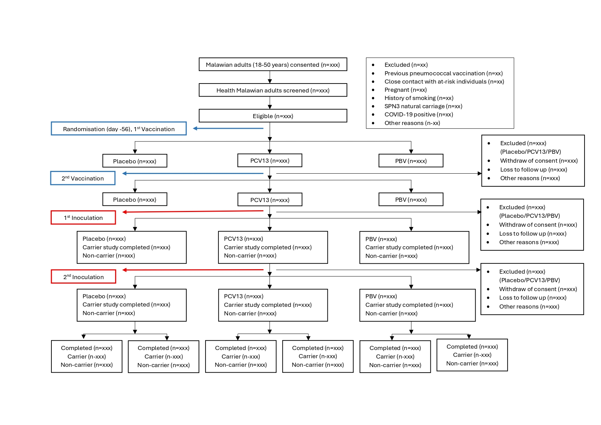

```{r setup}
#| include: false

library(tidyverse)
library(kableExtra)
library(knitr)
library(table1)
library(gridExtra)
```

# SAP approval and sign-off

By signing below, the undersigned confirm that they have reviewed this Statistical Analysis Plan (version 1.1) for the MARVELS PBV-CHIM study and approve it for use in the final analysis.

| Role | Name | Signature | Date |
|:-----|:-----|:----------|:-----|
| Chief Investigator | Prof. Stephen B. Gordon | <br><br>_________________________ | <br><br>______________ |
| Principal Investigator | Dr. Anthony E. Chirwa | <br><br>_________________________ | <br><br>______________ |
| Study Statistician | Dr. Marc Y.R. Henrion | <br><br>_________________________ | <br><br>______________ |

: SAP sign-off {tbl-colwidths="[22,28,32,18]"}

This initial SAP is outlined in sections that are to be updated according to the PBV CHIM study protocol. We will keep track of all changes made to each SAP version and document these in the version history table.

# Full study title

Vaccine prevention of pneumococcal carriage using PnuBioVax (PBV) and pneumococcal conjugate vaccine (PCV) in an SPN3 controlled human infection model 

# Short title

PBV and Pneumococcal Colonisation in Malawi

# Acronym

PBV-CHIM

# SAP Version History

```{r}
#| label: tbl-versionHistory
#| tbl-cap: "Version history listing major changes for each new version."

dfVersion<-data.frame(matrix(ncol=3,nrow=0, dimnames=list(NULL, c("Version", "Date", "Description"))))

dfVersion[nrow(dfVersion)+1,]<-c("v0.1","2025-07-29","First draft of the SAP; Puting all sections in place and initial data simulations.")

dfVersion[nrow(dfVersion)+1,]<-c("v0.2","2025-08-05","Further data simulations.")

dfVersion[nrow(dfVersion)+1,]<-c("v0.2","2025-08-13","Included consort diagram.")

dfVersion[nrow(dfVersion)+1,]<-c("v0.3","2025-11-24","SAP shared with MH.")

dfVersion[nrow(dfVersion)+1,]<-c("v0.4","2025-12-02","Incorporating MH's comments.")

dfVersion[nrow(dfVersion)+1,]<-c("v0.5","2025-12-12","Revised SAP shared with MH.")

dfVersion[nrow(dfVersion)+1,]<-c("v0.6","2026-01-06","Incorporated comments from the meeting on 16 December 2025.")

dfVersion[nrow(dfVersion)+1,]<-c("v0.7","2026-01-26","Incorporated comments from AEC.")

dfVersion[nrow(dfVersion)+1,]<-c("v1.0","2026-01-30","First effective version.")

dfVersion[nrow(dfVersion)+1,]<-c("v1.1","2026-10-16","Analysis population clarification (PP and ITT). BMI added to participant characteristics table. Education categories. SES group definitions according to tertiles. Extended symptom list. Satisfaction review stratified by study exit. Clarification on interim blinded data reviews.")

dfVersion[nrow(dfVersion)+1,]<-c("v1.2","2026-10-19","Revision to participant characteristics table (added natural carriage; clarified that sex is reported sex.). Additional details on immunogenicity analyses. Clarification that the primary analysis will also, as exploratory and descriptive analysis, be stratified by single / double inoculation status.")

dfVersion[nrow(dfVersion):1,] %>%
  kable(row.names = FALSE) %>%
  kable_styling(full_width = FALSE)
```

# List of abbreviations

@tbl-abbr lists all abbreviations used throughout this document.

```{r}
#| echo: false
#| label: tbl-abbr
#| tbl-cap: "List of abbreviations"

dfAbbr<-data.frame(
  abbr=c("eCRF","AE","AR","SAE","SAR","SUSAR", "DMP", "SAP", "IDA", "IQR", "CI", "SD", "P25", "P75", "N", "n", "ITT", "MICE", "FCS", "LTFU", "GM"),
  details=c("Electronic Case report form","Adverse event","Adverse reaction","Serious adverse event","Serious adverse reaction","Suspected unexpected serious adverse reaction", "Data management plan", "Statistical analysis plan", "Initial data analysis", "Interquartile range", "Confidence interval", "Standard deviation", "25th percentile value", "75th percentile value", "Size of relevant analysis population", "Size of analysis population without missing values", "Intention-to-treat", "Multiple imputation using chained equations", "Fully conditional specification", "Loss to follow-up", "Geometric mean")
)

dfAbbr<-dfAbbr[order(dfAbbr$abbr),]

dfAbbr %>%
  kable(row.names=F,col.names=c("Abbreviation","Explanation")) %>%
  kable_styling(full_width=FALSE)
```

# Protocol version

This Statistical Analysis Plan (SAP) v1.2 is based on Protocol v1.4, dated 3 Feb 2025 and approved by NHSRC.

# Protocol summary

The overall objective of the MARVELS PBV-CHIM is to determine if PCV-13 or PBV vaccination is protective against experimental SPN3 pneumococcal carriage in healthy adult Malawian volunteers.

## Study design

A double-blinded randomised controlled trial of adult healthy human participants experimentally exposed to Streptococcus pneumoniae in the nasopharynx. The intervention vaccines will be PBV (PnuBioVax) and PCV-13 and the control vaccine will be 0.9% saline. We will closely monitor study participants to ensure safety and tolerability of study procedures. We will measure immune protective responses to Streptococcus pneumoniae challenge using mucosal (nasal and throat) and blood samples.

Healthy adult participants aged 18-50 will be randomised either to the intevention arms (PBV or PCV-13), or to the 0.9% saline group. They will be observed for safety and development of pneumococcal colonisation and immune responses.

## Inclusion and exclusion criteria

### Inclusion criteria

- Adults aged 18-50 years - ages chosen to minimise the risk of pneumococcal infection.

- Fluent spoken and written Chichewa or English - to ensure a comprehensive understanding of the research project, their proposed involvement and communication with all members of the research team

- Owning a cellphone for easy communication with  the clinic team

### Exclusion criteria

-  Previous pneumococcal vaccination 

- Inoculation in pneumococcal controlled human infection studies (inoculation with bacteria may confer immunity) in the last year.

-  HIV-infection seropositive. HIV self-test kits will be used by participants to confirm infection status in the presence of the research team. Any seropositive participant will be referred to trained personnel certified in HIV Testing Services (HTS) for confirmatory “Determine” and “Unigold” tests. Any participants confirmed as HIV-infection positive will be referred to the governmental system for infection confirmation, treatment and follow-up.

-  Close physical contact (e.g. sleeping in the same room or nursing) with at-risk individuals (children under 5 years age, immunosuppressed adults, elderly, chronic ill health)

- Allergy to penicillin/amoxicillin

-  Acute illness

      -	Current illness
      -	Acute illness within 3 days prior to inoculation 
      -	Antibiotic treatment within 2 weeks of inoculation
      
- Chronic illness that may impair immune response or impair ability to comply with study procedures and safety monitoring (e.g. HIV, diabetes). 

- Taking immunosuppressive medication that may include but is not limited to steroids and steroid nasal spray.

- Pregnancy - minimise risk of pneumococcal disease

- Involved in another clinical trial unless observational or in follow-up (non-interventional) phase

-  History of drug or alcohol abuse. This is very difficult to ascertain in a history therefore we will exclude people reporting drinking alcohol more than twice per week. 

- History of Smoking 

      -	Current regular smoker (smokes daily/ smokes > 5 cigarettes per week) - 
        minimise risk of pneumococcal disease
      
      -	Recent smoker i.e. within the last 6 months - minimise risk of pneumococcal disease
      
      -	Ex-smoker with a significant smoking history (>10 pack years) – minimise
        risk of pneumococcal disease
      
-  Unable to give informed consent

-  In case of any uncertainty or concern, the PI will take clinical responsibility for the decision.


## Withdrawal criteria

Participants will be informed in both the participant information leaflet and participant presentation that they may withdraw from the study at any time and that this will not have any effect on them. Samples already collected prior to withdrawal will continue to be used in the research.

Participants may be withdrawn from the study for the following reasons:

-   If they become pregnant.
-   If they develop a condition that forms part of exclusion criteria.
-   If a medication is started that would affect the study results (e.g., antibiotics).
-   Any concern about participant safety including that posed by new medication prescriptions or medical issues, or compliance with monitoring appointments (at the discretion of the study physician).

### Replacement of withdrawn or lost-to-follow-up participants

We will replace participants who are excluded during post-inoculation follow-up to recruit the pre-specified allocated number of participants to each study group.

## Study Endpoints

**Primary endpoint**:

The primary endpoint is detection of the inoculated pneumococci by classical culture methods, at any time point, from nasal wash recovered from the participants at days 2, 7 and 14 following the primary pneumococcal inoculation or at days 16, 21 and 28 following the secondary pneumococcal inoculation.

**Secondary endpoints**:

- Pneumococcal carriage density 

- Pneumococcal carriage duration 

- IgG antibodies, neutrophil-to-T-cell ratio and other immunological biomarkers 

## Sample size

This will be a trial with 3 parallel arms with 2 experimental arms compared against a common control arm. Assuming 80% target power, significance level α=0.025 (adjusted for 2 null hypothesis significance tests being done using the Bonferroni correction), 56.0% SPN3 carriage in the control arm and a minimum vaccine efficacy that we want to be able to detect of 35% relative reduction in carriage (i.e. 36.4% carriage in the experimental arms), we need to recruit 122 participants in the control and PCV13 arms.  For the PBV arm, in order to test both the 200ug and 500ug dose, we will recruit 86 participants at the lower dose and then a further 86 at the higher dose, i.e. a total of 172 in the PBV arm and a grand total of 416 participants for the 3 arms. For an exploratory analysis that we have not powered for, with the above assumptions we will have 49% power to detect a difference between PBV and PCV-13, should PCV-13 only have 10% vaccine efficacy.

## Aims and objectives

**Main objective:**

To determine if PCV-13 or PBV vaccination is protective against experimental SPN3 pneumococcal carriage in healthy adult Malawian volunteers.

**Secondary objectives**

The secondary objectives are:

- To observe the rate of naturally acquired pneumococcal carriage in PBV, PCV-13 and placebo-vaccinated participants

- To examine local and systemic innate, humoral and cellular responses to PBV, and PCV-13, in participants with and without pneumococcal nasal carriage

- To explore participant experience in the study to monitor acceptability of PBV compared to PCV.

# Data simulation

In order to demonstrate the planned analyses and show computer code, we will simulate mock study data.

## Generate mock data


```{r Simulation}
set.seed(123)
n=416 # sample size

mockDat<-data.frame(
  #generate personal identification number
  PID=formatC(c(1:122, 1:122, 1:172), width = 3, format = "d", flag = "0"),
  
  #generate treatment group
  treatGroup = c(rep("Control", 122), rep("PCV13", 122), rep("PBV", 172)),
  
  #gender and age
  sex=sample(size=n,x=c("Male","Female"),prob=c(0.60,0.40),replace=T),
  
  
  age = round(rnorm(n, mean = 25, sd = 6.5), 1),
  
  bmi = round(digits=1,rnorm(n,mean=22,sd=1.5)),
  
  #participant type
 # participantType = sample(size=n,x=c("Community","Student"),prob=c(0.70,0.30),replace=T), 
  
  #education. None / Primary / Secondary / University enrolment
  education = sample(size = n,
                x = c("None", "Primary", "Secondary", "University enrolment"),
                prob=c(0.05, 0.35, 0.4, 0.2),replace=T),
  
  #----------------------------------------------------------------------------
  #Household wealth status
  
  #type of sleeping material
  sleep = sample(size = n,
                 x=c("Bed & mattress", "Bed & Mat (Grass)", "Bed alone",
                     "Mattress on floor", "Matt (Grass) on floor",
                     "Cloth/Sack on floor", "Floor (nothing else)",
                     "Other"),
                 
                 prob = c(0.05, 0.2, 0.2, 0.2, 0.1, 0.1, 0.05, 0.1),
                 
                 replace = TRUE
                 ),

  
  #number of people in household
  num_people = ceiling(rnorm(n, mean = 4, sd = 1.5)) ,
  
  #house has electricity
  electricity = sample(size=n,x=c("No","Yes"),prob=c(0.75,0.25),replace=T) ,
  
  #bank account
  bank_account = sample(size=n,x=c("No","Yes"),prob=c(0.55,0.45),replace=T) ,
  
  #enough_food
  enough_food = sample(size=n,x=c("No","Yes"),prob=c(0.65,0.35),replace=T) ,
  
  #household clothing
  household_clothing = sample(size=n,x=c("Less than adequate for HH needs",
                                         "Just adequate for HH needs",
                                         "More than adequate for HH needs"),
                              prob=c(0.35,0.35, 0.35),replace=T) ,
  
  #sound device
  sound_device = sample(size=n,x=c("No","Yes"),prob=c(0.65,0.35),replace=T) ,
  
  #arm_chair
  arm_chair = sample(size=n,x=c("No","Yes"),prob=c(0.55,0.45),replace=T) ,
  
  #iron
  iron  = sample(size=n,x=c("No","Yes"),prob=c(0.60,0.40),replace=T) ,
  
  #six steps
  six_steps = sample(size = n,
                x = c("Step 1", "Step 2", "Step 3", "Step 4", "Step 5",
                      "Step 6"),
                
                prob=c(0.2, 0.2, 0.2, 0.2, 0.1, 0.1),replace=T),
  
  #-----------------------------------------------------------------------------
  
  #dose
  inoculation = c(rep("Saline", 122), rep("PCV13", 122), 
                  rep("200ugPBV", 86), rep("500ugPBV", 86)),
  
  dose =  rep(320000,n) ,
  
  #-----------------------------------------------------------------------------
  actualDosePre=NA,
  actualDosePost=NA,
  
  min_temperature=NA,
  max_temperature=NA,
  
  doseTimeDiff=NA,
  inoculation=NA,
  
  carriageSPN3=NA,
  carriageSPN3_D2=0,
  carriageSPN3_D5=0,
  carriageSPN3_D7=0,
  carriageSPN3_D14=0,
  carriageSPN3_D16=0,
  carriageSPN3_D21=0,
  carriageSPN3_D28=0,
  
  #non SPN3 carriage
  carriageNonSPN3=NA,
  carriageNonSPN3_D5=0,
  carriageNonSPN3_D2=0,
  carriageNonSPN3_D7=0,
  carriageNonSPN3_D14=0,
  carriageNonSPN3_D16=0,
  carriageNonSPN3_D21=0,
  carriageNonSPN3_D28=0,
  
  #assume that 35% of the participants will have natural S. pneumoniae carriage at the inoculation visit.
 # baseline_carriage = sample(size=n,x=c("No","Yes"),prob=c(0.65,0.35),replace=T),
  
  #SPN3 density
  densitySPN3_D2=0,
  densitySPN3_D7=0,
  densitySPN3_D14=0,
  densitySPN3_D16=0,
  densitySPN3_D21=0,
  densitySPN3_D28=0,
  
  AE1=0,
  AE2=0,
  AE3=0,
  sym1=NA,
  sym2=NA,
  sym3=NA,
  SAE=0,
  SAR=0,
  SUSAR=0
)

symptoms<-c("Sore throat","Coryzal symptoms","Headache","Earache","Feverish","Cough or sputum","Fatigue","Short of breath or chest pain","Joint / muscle pain","Vomitting / diarrhoea","Other")
sympProb<-c(0.3,0.02,0.09,0.13,0.09,0.13,0.09,0.02,0.05,0.04,0.04)

mockDat$PID<-paste(sep="-","PBV-CHIM",mockDat$treatGroup,mockDat$PID)

mockDat$actualDosePre<-rnorm(nrow(mockDat),mean=mockDat$dose,sd=mockDat$dose/25)
mockDat$actualDosePost<-rnorm(nrow(mockDat),mean=mockDat$actualDosePre,sd=ifelse(mockDat$dose==0,0,800))

mockDat$doseTimeDiff <-round(digits=0,rnorm(nrow(mockDat),mean=45,sd=10))

mockDat$min_temperature<-round(digits=1,rnorm(nrow(mockDat),mean=22,sd=1.5))
mockDat$max_temperature<-mockDat$min_temperature+round(digits=1,abs(rnorm(nrow(mockDat),mean=2,sd=0.5)))

#-------------------------------------------------------------------------------
#add participant type and baseline carriage to avoid complete separation 
#during modelling

set.seed(123)
mockDat$participantType <- sample(c("Community","Student"), size=n, replace=TRUE, prob=c(0.5,0.5))
mockDat$baseline_carriage <- sample(c("Yes","No"), size=n, replace=TRUE, prob=c(0.35,0.65))

# Target arm probabilities
arm_probs <- c(Control=0.50, PCV13=0.34, PBV=0.30)

# Base probabilities by treatment group
p <- ifelse(mockDat$treatGroup=="Control", arm_probs["Control"],
            ifelse(mockDat$treatGroup=="PCV13", arm_probs["PCV13"], arm_probs["PBV"]))

# covariate effects
p <- p * ifelse(mockDat$participantType=="Community", 1.10, 1)
p <- p * ifelse(mockDat$baseline_carriage=="Yes", 1.15, 1)

#  individual-level variation
set.seed(123)
p <- p * rlnorm(n, meanlog=0, sdlog=0.2)

# restrict probabilities
p_base <- pmin(pmax(p, 0.15), 0.85)

# Simulate outcome
mockDat$carriageSPN3 <- rbinom(n, 1, p_base)

# Quick checks
#range(p_base)
#summary(p_base)
#with(mockDat, tapply(carriageSPN3, treatGroup, mean))


```


```{r, furtherDatasimulations1}

mockDat$substage <- NA

for(grp in unique(mockDat$treatGroup)){
  idx <- which(mockDat$treatGroup == grp)
  n_idx  <- length(idx)
  # randomly split into 1 and 2
  mockDat$substage[idx] <- sample(c(1,2), size=n_idx, replace=TRUE, prob=c(0.6,0.5))
}

```


```{r, furtherDatasimulations2}

#-------------------------------------------------------------------------------

### Initialise FOLLOW-UP DAY columns
days <- c("D2","D7","D14","D16","D21","D28")
for(d in days){
  mockDat[[paste0("carriageSPN3_", d)]] <- 0
}

#-------------------------------------------------------------------------------

### visit carriage - substage 1 (single inoculation)
idxTmp <- which(mockDat$carriageSPN3 == 1 & mockDat$substage == 1)

carDayTmp <- sample(
  c(2,7),
  size = length(idxTmp),
  prob = c(0.4, 0.6),
  replace = TRUE
)

# D2 carriage
mockDat$carriageSPN3_D2[idxTmp[carDayTmp == 2]] <- 1

# D7 carriage (initial)
mockDat$carriageSPN3_D7[idxTmp[carDayTmp == 7]] <- 1

# D7 for D2 carriers
mockDat$carriageSPN3_D7[idxTmp[carDayTmp == 2]] <-
  sample(0:1, size=sum(carDayTmp==2), replace=TRUE, prob=c(0.7,0.3))

# D14
mockDat$carriageSPN3_D14[idxTmp[carDayTmp == 2]] <-
  sample(0:1, size=sum(carDayTmp==2), replace=TRUE, prob=c(0.85,0.15))

mockDat$carriageSPN3_D14[idxTmp[carDayTmp == 7]] <-
  sample(0:1, size=sum(carDayTmp==7), replace=TRUE, prob=c(0.75,0.25))

# D16, D21, D28 = NA for all substage 1
mockDat$carriageSPN3_D16[idxTmp] <- NA
mockDat$carriageSPN3_D21[idxTmp] <- NA
mockDat$carriageSPN3_D28[idxTmp] <- NA


# visit carriage - substage 2 (re-challenge) 

idxTmp <- which(mockDat$carriageSPN3 == 1 & mockDat$substage == 2)

carDayTmp <- sample(
  c(13,16,21,28),
  size = length(idxTmp),
  prob = c(0.1,0.4,0.35,0.15),
  replace = TRUE
)

# D16
mockDat$carriageSPN3_D16[idxTmp[carDayTmp == 13]] <- 1
mockDat$carriageSPN3_D16[idxTmp[carDayTmp == 16]] <- 1
mockDat$carriageSPN3_D16[idxTmp[carDayTmp == 13]] <-
  sample(0:1, prob=c(0.8,0.2), size=sum(carDayTmp==13), replace=TRUE)

# D21
mockDat$carriageSPN3_D21[idxTmp[carDayTmp == 21]] <- 1
mockDat$carriageSPN3_D21[idxTmp[carDayTmp == 13]] <-
  sample(0:1, prob=c(0.95,0.15), size=sum(carDayTmp==13), replace=TRUE)
mockDat$carriageSPN3_D21[idxTmp[carDayTmp == 16]] <-
  sample(0:1, prob=c(0.8,0.2), size=sum(carDayTmp==16), replace=TRUE)

# D28
mockDat$carriageSPN3_D28[idxTmp[carDayTmp == 28]] <- 1
mockDat$carriageSPN3_D28[idxTmp[carDayTmp == 13]] <-
  sample(0:1, prob=c(0.98,0.02), size=sum(carDayTmp==13), replace=TRUE)
mockDat$carriageSPN3_D28[idxTmp[carDayTmp == 16]] <-
  sample(0:1, prob=c(0.9,0.1), size=sum(carDayTmp==16), replace=TRUE)
mockDat$carriageSPN3_D28[idxTmp[carDayTmp == 21]] <-
  sample(0:1, prob=c(0.8,0.2), size=sum(carDayTmp==21), replace=TRUE)


## Visit carriage for the single inoculated participants
idxTmp<-which(mockDat$carriageSPN3==1 & mockDat$substage==1)
carDayTmp<-sample(size=length(idxTmp),c(2,7),prob=c(0.4,0.6),replace=T)

mockDat$carriageSPN3_D2[idxTmp[carDayTmp==2]]<-1

mockDat$carriageSPN3_D7[idxTmp[carDayTmp==7]]<-1
mockDat$carriageSPN3_D7[idxTmp[carDayTmp==2]]<-sample(0:1,prob=c(0.7,0.3),replace=TRUE,size=sum(carDayTmp==2))

mockDat$carriageSPN3_D14[idxTmp[carDayTmp==2]]<-sample(0:1,prob=c(0.85,0.15),replace=TRUE,size=sum(carDayTmp==2))
mockDat$carriageSPN3_D14[idxTmp[carDayTmp==7]]<-sample(0:1,prob=c(0.75,0.25),replace=TRUE,size=sum(carDayTmp==2))

mockDat$carriageSPN3_D16[idxTmp[carDayTmp==2]]<-NA
mockDat$carriageSPN3_D16[idxTmp[carDayTmp==7]]<-NA

mockDat$carriageSPN3_D21[idxTmp[carDayTmp==2]]<-NA
mockDat$carriageSPN3_D21[idxTmp[carDayTmp==7]]<-NA

mockDat$carriageSPN3_D28[idxTmp[carDayTmp==2]]<-NA
mockDat$carriageSPN3_D28[idxTmp[carDayTmp==7]]<-NA

## Visit carriage for the re-challenged participants
idxTmp<-which(mockDat$carriageSPN3==1 & mockDat$substage==2)
carDayTmp<-sample(size=length(idxTmp),c(13,16,21,28),prob=c(0.1,0.4,0.35,0.15),replace=T)

mockDat$carriageSPN3_D16[idxTmp[carDayTmp==13]]<-1

mockDat$carriageSPN3_D16[idxTmp[carDayTmp==16]]<-1
mockDat$carriageSPN3_D16[idxTmp[carDayTmp==13]]<-sample(0:1,prob=c(0.8,0.2),replace=TRUE,size=sum(carDayTmp==13))

mockDat$carriageSPN3_D21[idxTmp[carDayTmp==21]]<-1
mockDat$carriageSPN3_D21[idxTmp[carDayTmp==13]]<-sample(0:1,prob=c(0.95,0.15),replace=TRUE,size=sum(carDayTmp==13))
mockDat$carriageSPN3_D21[idxTmp[carDayTmp==16]]<-sample(0:1,prob=c(0.8,0.2),replace=TRUE,size=sum(carDayTmp==16))

mockDat$carriageSPN3_D28[idxTmp[carDayTmp==28]]<-1
mockDat$carriageSPN3_D28[idxTmp[carDayTmp==13]]<-sample(0:1,prob=c(0.98,0.02),replace=TRUE,size=sum(carDayTmp==13))
mockDat$carriageSPN3_D28[idxTmp[carDayTmp==16]]<-sample(0:1,prob=c(0.9,0.1),replace=TRUE,size=sum(carDayTmp==16))
mockDat$carriageSPN3_D28[idxTmp[carDayTmp==21]]<-sample(0:1,prob=c(0.8,0.2),replace=TRUE,size=sum(carDayTmp==21))

# lytA carriage
mockDat<-mockDat %>%
  dplyr::mutate(
    carriageSPN3_D2_lytA=rbinom(n=n(),size=1,prob=ifelse(carriageSPN3_D2==1,0.95,0.05)),
    carriageSPN3_D7_lytA=rbinom(n=n(),size=1,prob=ifelse(carriageSPN3_D7==1,0.95,0.05)),
    carriageSPN3_D14_lytA=rbinom(n=n(),size=1,prob=ifelse(carriageSPN3_D14==1,0.95,0.05)),
    carriageSPN3_D16_lytA=rbinom(n=n(),size=1,prob=ifelse(carriageSPN3_D16==1,0.95,0.02)),
    carriageSPN3_D21_lytA=rbinom(n=n(),size=1,prob=ifelse(carriageSPN3_D21==1,0.95,0.02)),
    carriageSPN3_D28_lytA=rbinom(n=n(),size=1,prob=ifelse(carriageSPN3_D28==1,0.95,0.02))
  )

mockDat$carriageSPN3_D16_lytA[is.na(mockDat$carriageSPN3_D16)]<-NA
mockDat$carriageSPN3_D21_lytA[is.na(mockDat$carriageSPN3_D21)]<-NA
mockDat$carriageSPN3_D28_lytA[is.na(mockDat$carriageSPN3_D28)]<-NA

mockDat<-mockDat %>%
  dplyr::mutate(
    carriageSPN3_lytA=max(carriageSPN3_D2_lytA,carriageSPN3_D7_lytA,carriageSPN3_D14_lytA,carriageSPN3_D16_lytA,carriageSPN3_D21_lytA,carriageSPN3_D28_lytA,na.rm=TRUE)
  )

# Carriage Density for carriers
mockDat$densitySPN3_D2[mockDat$carriageSPN3_D2==1]<-rexp(sum(mockDat$carriageSPN3_D2==1),rate=5/mockDat$dose[mockDat$carriageSPN3_D2==1])

mockDat$densitySPN3_D7[mockDat$carriageSPN3_D7==1 & mockDat$carriageSPN3_D2==1]<-rexp(sum(mockDat$carriageSPN3_D7==1 & mockDat$carriageSPN3_D2==1),rate=1/mockDat$densitySPN3_D2[mockDat$carriageSPN3_D7==1 & mockDat$carriageSPN3_D2==1])

mockDat$densitySPN3_D7[mockDat$carriageSPN3_D7==1 &
                         mockDat$carriageSPN3_D2==0]<-rexp(sum(mockDat$carriageSPN3_D7==1 & mockDat$carriageSPN3_D2==0),rate=5/mockDat$dose[mockDat$carriageSPN3_D7==1 & mockDat$carriageSPN3_D2==0])

mockDat$densitySPN3_D14[mockDat$carriageSPN3_D14==1 & mockDat$carriageSPN3_D7==1]<-rexp(sum(mockDat$carriageSPN3_D14==1 & mockDat$carriageSPN3_D7==1),rate=1/mockDat$densitySPN3_D7[mockDat$carriageSPN3_D14==1 & mockDat$carriageSPN3_D7==1])

mockDat$densitySPN3_D14[mockDat$carriageSPN3_D14==1 & mockDat$carriageSPN3_D7==0]<-rexp(sum(mockDat$carriageSPN3_D14==1 & mockDat$carriageSPN3_D7==0),rate=5/mockDat$dose[mockDat$carriageSPN3_D14==1 & mockDat$carriageSPN3_D7==0])

mockDat$densitySPN3_D2<-round(mockDat$densitySPN3_D2,digits=0)
mockDat$densitySPN3_D7<-round(mockDat$densitySPN3_D7,digits=0)
mockDat$densitySPN3_D14<-round(mockDat$densitySPN3_D14,digits=0)

# Non-SPN3 carriage 
mockDat$carriageNonSPN3_D2<-rbinom(size=1,n=nrow(mockDat),prob=1/(12*7))
mockDat$carriageNonSPN3_D5<-rbinom(size=1,n=nrow(mockDat),prob=1/(12*7))
mockDat$carriageNonSPN3_D7<-rbinom(size=1,n=nrow(mockDat),prob=1/(12*7))
mockDat$carriageNonSPN3_D14<-rbinom(size=1,n=nrow(mockDat),prob=1/(12*7))
mockDat$carriageNonSPN3_D16<-rbinom(size=1,n=nrow(mockDat),prob=1/(12*7))
mockDat$carriageNonSPN3_D21<-rbinom(size=1,n=nrow(mockDat),prob=1/(12*7))
mockDat$carriageNonSPN3_D28<-rbinom(size=1,n=nrow(mockDat),prob=1/(12*7))

mockDat$carriageNonSPN3=apply(FUN=max,MARGIN=1,X=mockDat %>% select(carriageNonSPN3_D5,carriageNonSPN3_D2,carriageNonSPN3_D7,carriageNonSPN3_D14,carriageNonSPN3_D16,carriageNonSPN3_D21,carriageNonSPN3_D28),na.rm=TRUE)

mockDat$AE1<-sample(0:1,size=nrow(mockDat),prob=c(0.75,0.25),replace=T)
mockDat$AE2[mockDat$AE1==1]<-sample(0:1,size=sum(mockDat$AE1==1),prob=c(0.9,0.1),replace=T)
mockDat$AE3[mockDat$AE2==1]<-sample(0:1,size=sum(mockDat$AE2==1),prob=c(0.95,0.05),replace=T)

mockDat$sym1[mockDat$AE1==1]<-sample(symptoms,size=sum(mockDat$AE1==1),prob=sympProb,replace=T)
mockDat$sym2[mockDat$AE2==1]<-sample(symptoms,size=sum(mockDat$AE2==1),prob=sympProb,replace=T)
mockDat$sym2[mockDat$AE3==1]<-sample(symptoms,size=sum(mockDat$AE3==1),prob=sympProb,replace=T)

```


## Generating socio-economic status (SES) indicators and developing a SES variable

This section simulates socio-economic status (SES) variables collected at screening. It includes variables such as household size, electricity availability in the dwelling, and the type of sleeping material. We will derive a wealth score using Principal Components Analysis (PCA), using the first principal component as the score, as in previous studies (this is the Filmer & Pritchett (2001) method). We will then categorize the continuous wealth score into Low, Middle, and High groups using tertiles.

```{r, SESDataSimulation}
set.seed(2026)

mockDat <- mockDat %>%
  mutate(
    
    # Q2: Sleeping arrangement of household head
    hh_sleep = sample(
      c("Bed & mattress",
        "Bed & mat (grass)",
        "Bed alone",
        "Mattress on floor",
        "Mat (grass) on floor",
        "Cloth/sack on floor",
        "Floor (nothing else)",
        "Other"),
      size = n,
      replace = TRUE,
      prob = c(0.25, 0.10, 0.06, 0.25, 0.15, 0.10, 0.09, 0)
    ),
    
    # Q3: Household size
    hh_size = pmin(
      rpois(n, lambda = 4) + 1,   # ensure min of 1 hHH resident
      12                          # cap at a realistic upper bound
    ),
    
    # Q4: Working electricity in dwelling
    electricity = sample(
      c("Yes", "No"),
      size = n,
      replace = TRUE,
      prob = c(0.45, 0.55)
    ),
    
    # Q5: Household has a bank / financial account
    bank_account = sample(
      c("Yes", "No"),
      size = n,
      replace = TRUE,
      prob = c(0.40, 0.60)
    ),
    
    # Q6: Worried about food in past 7 days
    food_worry = sample(
      c("Yes", "No"),
      size = n,
      replace = TRUE,
      prob = c(0.55, 0.45)
    ),
    
    # Q7: Household clothing adequacy
    clothing_adequacy = sample(
      c("Less than adequate",
        "Just adequate",
        "More than adequate"),
      size = n,
      replace = TRUE,
      prob = c(0.40, 0.45, 0.15)
    ),
    
    # Q8: Owns tape / CD / DVD / HiFi
    owns_audio_player = sample(
      c("Yes", "No"),
      size = n,
      replace = TRUE,
      prob = c(0.35, 0.65)
    ),
    
    # Q9: Owns upholstered chair or sofa
    owns_sofa = sample(
      c("Yes", "No"),
      size = n,
      replace = TRUE,
      prob = c(0.30, 0.70)
    ),
    
    # Q10: Owns an iron
    owns_iron = sample(
      c("Yes", "No"),
      size = n,
      replace = TRUE,
      prob = c(0.55, 0.45)
    ),
    
    # Q11: Subjective wealth ladder (1 = poorest, 6 = richest)
    wealth_step = sample(
      1:6,
      size = n,
      replace = TRUE,
      prob = c(0.20, 0.25, 0.25, 0.18, 0.08, 0.04)
    )
  )

#===============================================================================
#use the Principal Components Analysis (PCA) to derive a wealth score

# Prepare variables for PCA

# Asset style coding: recoding categorical variables to numeric 

pca_dat <- mockDat %>%
  transmute(
    # Sleeping arrangement (ordered from poorest to best)
    sleep_score = case_when(
      hh_sleep == "Floor (nothing else)"      ~ 0,
      hh_sleep == "Cloth/sack on floor"       ~ 1,
      hh_sleep == "Mat (grass) on floor"      ~ 2,
      hh_sleep == "Mattress on floor"         ~ 3,
      hh_sleep == "Bed alone"                 ~ 4,
      hh_sleep == "Bed & mat (grass)"         ~ 5,
      hh_sleep == "Bed & mattress"            ~ 6,
      TRUE                                    ~ NA_real_
    ),
    
    hh_size = hh_size,  # household size 
    
    electricity = ifelse(electricity == "Yes", 1, 0),
    bank_account = ifelse(bank_account == "Yes", 1, 0),
    food_worry = ifelse(food_worry == "No", 1, 0),  # reverse-coded (less worry = wealthier)
    clothing_adequacy = case_when(
      clothing_adequacy == "Less than adequate"  ~ 0,
      clothing_adequacy == "Just adequate"       ~ 1,
      clothing_adequacy == "More than adequate"  ~ 2
    ),
    owns_audio_player = ifelse(owns_audio_player == "Yes", 1, 0),
    owns_sofa = ifelse(owns_sofa == "Yes", 1, 0),
    owns_iron = ifelse(owns_iron == "Yes", 1, 0),
    wealth_step = wealth_step
  )

# Remove incomplete rows for PCA
#pca_complete <- pca_dat[complete.cases(pca_dat), ]

#run PCA

pca_res <- prcomp(pca_dat,center = TRUE,scale. = TRUE)

# Extract first principal component as wealth score
wealth_score <- pca_res$x[, 1]

# Standardise score to have a mean 0 and standard deviation of 1
wealth_score_z <- scale(wealth_score)

#Attach wealth score back to data

mockDat$wealth_score <- NA_real_
mockDat$wealth_score[complete.cases(pca_dat)] <- as.numeric(wealth_score_z)

# Create socio-economic status (SES) wealth groups (Low / Middle / High) 

mockDat <- mockDat %>%
  arrange(wealth_score) %>%  # low scores = poorer households
  mutate(
    SES_group = case_when(ntile(wealth_score, 3) == 1 ~ "Low",
                          ntile(wealth_score, 3) == 2 ~ "Middle",
                          TRUE                        ~ "High"),
    # SES_group = case_when(
    #   row_number() <= round(0.45 * n) ~ "Low",
    #   row_number() <= round((0.45 + 0.30) * n) ~ "Middle",
    #   TRUE ~ "High"
    # )
  )

# Convert to ordered factor
mockDat$SES_group <- factor(
  mockDat$SES_group,
  levels = c("Low", "Middle", "High"),
  ordered = FALSE
)

# Check distribution of socio-ecoonomic variable
#table(mockDat$SES_group)

```

### Summary statistics for the simulated data

Below is the summary statistics for the simulated data showing: numbers of participants, sex (male/female) distribution, colonisation rates for each dose and for the PBV CHIM study

```{r}
# 1. Bar chart: Participants per study group
mockDat$treatGroup <- factor(mockDat$treatGroup, levels = c("Control", "PCV13",
                                                            "PBV"))

ggplot(mockDat, aes(x = as.factor(treatGroup), fill = treatGroup)) +
  geom_bar() +
    scale_fill_manual(values = c("steelblue", "darkseagreen3","lightgoldenrod1"), name = "Study arm") +
  labs(title = "Number of Participants per study group", x = "Group", y = "Count") +
  theme_bw() +
  theme(legend.position = "none")

# 2. Bar chart: Sex distribution
ggplot(mockDat, aes(x = sex, fill = sex)) +
  geom_bar() +
  labs(title = "Sex Distribution", x = "Sex", y = "Count") +
  theme_bw()


# CarriageSPN3 by study group
simDat <- mockDat
plotDat<-simDat %>%
  group_by(treatGroup) %>%
  summarise(
    n=n(),
    k=sum(carriageSPN3),
    .groups="drop") %>%
  mutate(
    prop=k/n,
    propLow=NA,
    propUpp=NA
  )

for(j in 1:nrow(plotDat)){
  ci<-binom.test(x=plotDat$k[j],n=plotDat$n[j])$conf.int
  plotDat$propLow[j]<-ci[1]
  plotDat$propUpp[j]<-ci[2] 
}

rm(ci)


plotDat %>%
  ggplot(mapping=aes(x=as.factor(treatGroup),y=prop,ymin=propLow,ymax=propUpp,fill=treatGroup)) +
  scale_fill_manual(values = c("steelblue", "darkseagreen3","lightgoldenrod1"), name = "Study arm") +
  geom_bar(stat="identity",alpha=0.9) +
  geom_errorbar(width=0.2,col="darkgrey") +
  #scale_fill_manual(values=c(blueCols,orangeCols)) +
  xlab("Inoculation dose") +
  ylab("carriage proportion") +
  guides(fill="none") +
  theme_bw() +
 # facet_wrap(~phase)+
  labs(title="Simulated data: carriage proportion per study group.",caption="The confidence interval bars are only indicative of how wide confidence intervals can be expected for such data.")
```

# Statistical Analysis Plan

The R code to generate the results is embedded in this document. By default it is hidden, but can be displayed by clicking on the `Show the code` indicators.

## General considerations

The reporting of this study will be prepared in accordance with the CONSORT 2025 guidelines [@hopewell_etal2025].

All continuous data variables will be summarized using the following descriptive statistics:

-   N (size of relevant analysis population)
-   n (size of analysis population without missing values)
-   arithmetic mean (or geometric mean if more appropriate)
-   standard deviation (SD)
-   median
-   25th percentile value (P25), 75th percentile value (P75) and interquartile range (IQR)
-   minimum and maximum (where relevant)

The proportion / percentage of observed levels will be reported for all binary and categorical measures. When appropriate, corresponding exact 95% confidence intervals (CIs) for proportions will be included.

For statistical test, a significance level of 5% will be used. All p-values will be reported to 3 decimal digits.

### Reporting conventions

P-values $\geq 0.001$ and $\leq 0.999$ will be reported to 3 decimal places; p-values less than 0.001 will be reported as "\< 0.001". The mean, standard deviation, median, IQR and other statistics will be reported to one decimal place greater than the original data. Minimum and maximum values will use the same number of decimal places as the original data. Proportions will be presented as two decimal places; values greater than zero but $<0.01$ will be presented as "\< 0.01". Percentages will be reported to 2 decimal places; values greater than zero but $<0.01\%$ will be presented as "\< 0.01%"; values greater than $99.99\%$ but less than $100\%$ will be reported as "\> 99.99%". Estimated parameters, not on the same scale as raw observations (e.g. regression coefficients) will be reported to 3 significant figures.

### Missing data

As participants who withdraw or become ineligible post vaccination and post inoculation will be replaced. For this reason, the main analysis will be a complete-case analysis.

While we do not anticipate much missing data, should missing data, for whatever reason, be more substantial than expected, we will use multiple imputation for the analysis. Specifically we will use fully conditional specification (FCS) as implemented in Multiple Imputation using Chained Equations (MICE, @vanBuurenGroothuisOudshoorn2011) and the `mice` package in R, with at least m=5 imputations or more if the missingness proportion is substantial.

### Technical details

The R environment for statistical computing (v4.5.2 or later) will be used for all analyses.

All analysis code will be made publicly available under an MIT or GNU GPL v3.0 license on GitHub.

All analysis code used for data simulation, statistical analysis, will be publicly available in a public GitHub repository under the MIT License.

The repository is accessible at:

[https://github.com/mlw-stats/MARVELS_PBV_CHIM_SAP](https://github.com/mlw-stats/MARVELS_PBV_CHIM_SAP)

### Analysis populations

For efficacy related endpoints, both the PP and the ITT populations below will be used. For safety data listings, the safety population will be used, through these may also be presented for the PP and ITT populations separately or stratified by study completion status.

#### Per protocol (PP)

This is the primary analysis population. It includes all participants who completed the study according to the protocol: 1) they passed eligibility criteria at screening, 2) they were randomised and received all doses of their allocated vaccine, 3) they received the SPN3 inoculation and 4) they attended all study visits as specified in the protocol and have complete data for all follow-up nasal wash samples at all scheduled post-inoculation time points (these include days 2, 7, and 14 for participants who received a single inoculation, and days 2, 7, 16, 21, and 28 for those who received a secondary inoculation).

Participants who completed the study satisfying criteria 1-3 above, but who deviated from the study visit schedule in a way where 1) their primary endpoint can still be evaluated and 2) a systematic deviation of that type would not bias carriage results, will also be included in the PP population.

#### Intention-to-treat (ITT)

The ITT population will be anybody who completed the study, but deviated in any way from the protocol mandated visits and data assessments (with the exception of the special case mentioned above for the PP population).

#### Safety population

This includes all participants who were enrolled and participated in at least one study activity regardless of their subsequent study completion status. Specifically, this includes all participants who received at least one dose of any vaccine or the inoculum.

### CONSORT diagram and participant characteristics

The very first analysis we will do will be descriptive: we will summarise the screening, recruitment, randomisation to vaccination arms, complete follow-up numbers using a standard CONSORT flow diagram as illustrated on Figure 1. The final diagram used may look slightly differently to the one shown below for reasons of presentation and clarity.

```{r}
#| label: fig-consort
#| fig-cap: "(MOCK FIGURE) CONSORT diagram for the PBV-CHIM study."
#| fig-height: 42
#| fig-width: 25
#| out.extra: "style='margin-top:-10px;'"


```

### Participant characteristics

We will list the participants' characteristics (reported sex, age, BMI, natural carriage at baseline, education level, SES group) by study arm, see @tbl-participantCharacteristics. This will be done for both the per protocol and the safety populations.

```{r}
#| label: tbl-participantCharacteristics
#| tbl-cap: "(MOCK TABLE) Participant characteristics."

mockDat$treatGroup <- factor(mockDat$treatGroup, levels = c("Control", "PCV13",
                                                            "PBV"))

mockDat$carriageSPN3_fct <- factor(mockDat$carriageSPN3, levels = c("0", "1"), labels = c("No", "Yes") )

render.median.IQR <- function(x, ...) {
  c('', 
    `Mean (SD)` = sprintf("%s (%s)", round(mean(x), 2), round(sd(x), 2)),
    `Median [IQR]` = sprintf("%s [%s, %s]", round(median(x),2), 
                             quantile(x, 0.25), quantile(x, 0.75)))
}

mockDat$education <- factor(mockDat$education,
                          levels = c(
                            "None",
                            "PLSC",
                            "JCE",
                            "MSCE",
                            "Non-university Diploma",
                            "University Diploma/Degree",
                            "Postgraduate Degree"
                          )
                        )


table1(~sex + age + bmi + baseline_carriage + education + SES_group | treatGroup, data = mockDat) #participantType #+  carriageSPN3_fct 
```


## Primary Analysis

The primary efficacy outcome is SPN3 colonisation, defined as detection of serotype SPN3 in nasal wash samples at any time point post-inoculation.

The primary analysis will use the per-protocol population, but will be repeated for the intention-to-treat population.

#### Overall carriage rates

We will summarise the proportion of participants who carried pneumococcal (serotype SPN3) following inoculation with SPN3 across the three study arms. Carriage rates are presented with corresponding 95% confidence intervals. 

```{r }
#| label: tbl-carriageRatesByStudyArm
#| tbl-cap: "(MOCK TABLE) SPN3 carriage rates by study group."

# overall carriage rates

carrRes<-mockDat %>%
  group_by(treatGroup) %>%
  summarise(
    n=n(),
    n_SPN3=sum(carriageSPN3==1),
    prop_SPN3=sum(carriageSPN3==1)/n(),
    prop_SPN3_low=NA,
    prop_SPN3_high=NA,
    propCI_SPN3=NA,
    n_NonSPN3=sum(carriageNonSPN3==1),
    prop_NonSPN3=sum(carriageNonSPN3==1)/n(),
    prop_NonSPN3_low=NA,
    prop_NonSPN3_high=NA,
    propCI_NonSPN3=NA
  )

for(j in 1:nrow(carrRes)){
  ci<-binom.test(x=carrRes$n_SPN3[j],n=carrRes$n[j])$conf.int
  carrRes$prop_SPN3_low[j]<-ci[1]
  carrRes$prop_SPN3_high[j]<-ci[2]
  ci<-paste(sep="",format(nsmall=1,round(digits=1,100*ci)),"%")
  carrRes$propCI_SPN3[j]<-paste(sep="","(",paste(collapse=",",ci),")")
  ci<-binom.test(x=carrRes$n_NonSPN3[j],n=carrRes$n[j])$conf.int
  carrRes$prop_NonSPN3_low[j]<-ci[1]
  carrRes$prop_NonSPN3_high[j]<-ci[2]
  ci<-paste(sep="",format(nsmall=1,round(digits=1,100*ci)),"%")
  carrRes$propCI_NonSPN3[j]<-paste(sep="","(",paste(collapse=",",ci),")")
  rm(ci)
}

carrRes$prop_SPN3_text<-paste(sep="",format(nsmall=1,round(digits=2,100*carrRes$prop_SPN3)),"%")
carrRes$prop_NonSPN3_text<-paste(sep="",format(nsmall=1,round(digits=2,100*carrRes$prop_NonSPN3)),"%")

carrRes %>%
  dplyr::select(treatGroup,n,n_SPN3,prop_SPN3_text,propCI_SPN3,n_NonSPN3,prop_NonSPN3_text,propCI_NonSPN3) %>%
  kable(row.names=F,col.names=c("","Total","Count","Percentage","95% CI","Count","Percentage","95% CI")) %>%
  kable_styling(full_width = F) %>%
  add_header_above(c(" "=2,"SPN3 Carriage"=3,"Non-SPN3 Carriage"=3))

write.csv(carrRes,file="MARVELS-PBVCHIM_Table8.1_CarriageRates.csv")
```

```{r}
#| label: fig-carriageRatesBygroup
#| fig-cap: "(MOCK FIGURE) SPN3 carriage rates by group."

g<-carrRes %>%
  ggplot(mapping=aes(x=treatGroup,y=prop_SPN3,fill=treatGroup)) +
  geom_bar(stat="identity",col=NA) +
  geom_errorbar(mapping=aes(ymin=prop_SPN3_low,ymax=prop_SPN3_high),width=0.15,col="grey60",lwd=0.75) +
  scale_fill_manual(values=c("steelblue", "darkseagreen3", "lightgoldenrod1"),name="") +
  guides(fill=FALSE) +
  theme_bw() +
  theme(text=element_text(size=10),
        axis.text.x = element_text(angle = 0, hjust = 1)) +
  xlab("Study arm") +
  ylab("Carriage proportion") +
  ggtitle("Carriage rates by treatment group") +
  ylim(c(0,1)) #+
  #geom_vline(xintercept=5.5,col="darkgrey",lwd=1.5,lty=2) 

print(g)

png(width=16,height=9,units="in",res=300,filename="MARVELS-PBVCHIM_Fig8.2_CarriageByGroup.png")
print(g)
dev.off()
```

As an exploratory and descriptive analysis only, this primary analysis will be repeated with stratification by single / double inoculation status.

### Experimental carriage by study group

The analysis below compares the proportion of participants with experimental S. 
pneumoniae serotype 3 (SPN3) carriage between each intervention arm (PBV and PCV13) and the control group. For each pairwise comparison, a 2×2 contingency table is constructed and analysed using Fisher’s exact test (see @tbl-ExperimentalCarriageByGroup).

The null hypothesis (H₀) for each comparison is that the risk of SPN3 carriage is 
equal in the intervention and control groups. The alternative hypothesis (H₁) is 
that the risk of SPN3 differs between groups.

Because two primary comparisons are performed (PBV vs Control and PCV13 vs Control), statistical significance is evaluated using Bonferroni-adjusted p-values. We report risk ratios (RR) and their 95% confidence intervals using the 
log-transformed standard error method. 


```{r, carriageproportionbygroup}
#| label: tbl-ExperimentalCarriageByGroup
#| tbl-cap: "(MOCK TABLE) Comparison of Experimental Carriage Between Study Arms and Control (Fisher's Exact Test, Bonferroni-adjusted."


###Create binary comparison variable datasetts for each arm

dat <- mockDat

# PBV vs Control
dat_pbv <- mockDat %>% filter(treatGroup %in% c("Control", "PBV"))
dat_pbv$arm <- factor(dat_pbv$treatGroup, levels = c("Control", "PBV"))

# PCV13 vs Control
dat_pcv <- dat %>% filter(treatGroup %in% c("Control", "PCV13"))
dat_pcv$arm <- factor(dat_pcv$treatGroup, levels = c("Control", "PCV13"))

# Number of comparisons for Bonferroni adjustment
n_tests <- 2

# Function to calculate RR and CI
risk_ratio_ci <- function(tab) {
  a <- tab[2,2]  # carriage in intervention
  b <- tab[2,1]  # carriage in control
  c <- tab[1,2]  # non-carriage in intervention
  d <- tab[1,1]  # non-carriage in control
  
  # Risk ratio
  rr <- (a / (a + c)) / (b / (b + d))
  
  # Standard error on log scale
  se <- sqrt( (1/a) - (1/(a + c)) + (1/b) - (1/(b + d)) )
  
  # CI
  ci_low <- exp(log(rr) - 1.96 * se)
  ci_high <- exp(log(rr) + 1.96 * se)
  
  list(rr = rr, ci_low = ci_low, ci_high = ci_high)
}

results_list <- list()

### PBV vs Control
tab_pbv <- table(dat_pbv$carriageSPN3, dat_pbv$arm)
fisher_pbv <- fisher.test(tab_pbv)
rr_pbv <- risk_ratio_ci(tab_pbv)
p_adj_pbv <- min(fisher_pbv$p.value * n_tests, 1)

results_list[[1]] <- data.frame(
  Comparison = "PBV vs Control",
  RR = round(rr_pbv$rr, 3),
  CI_low = round(rr_pbv$ci_low, 3),
  CI_high = round(rr_pbv$ci_high, 3),
  p_adj = round(p_adj_pbv, 3)
)

### PCV13 vs Control
tab_pcv <- table(dat_pcv$carriageSPN3, dat_pcv$arm)
fisher_pcv <- fisher.test(tab_pcv)
rr_pcv <- risk_ratio_ci(tab_pcv)
p_adj_pcv <- min(fisher_pcv$p.value * n_tests, 1)

results_list[[2]] <- data.frame(
  Comparison = "PCV13 vs Control",
  RR = round(rr_pcv$rr, 3),
  CI_low = round(rr_pcv$ci_low, 3),
  CI_high = round(rr_pcv$ci_high, 3),
  p_adj = round(p_adj_pcv, 3)
)

### Combine into a table
results_table <- do.call(rbind, results_list) %>%
  mutate(
    p_adj = ifelse(as.numeric(p_adj) < 0.001, "<0.001",
                   sprintf("%.3f", as.numeric(p_adj)))
  )

rownames(results_table) <- NULL

# Display
kable(results_table,
      caption = "Comparison of Experimental Carriage Between Study Arms and Control (Risk Ratios, Fisher's Exact Test, Bonferroni-adjusted)",
      col.names = c("Comparison", "Risk Ratio", "95% CI Low", "95% CI High", "Adjusted p-value"),
      align = "c",
      format = "html") %>%
  kable_styling(full_width = FALSE, position = "center",
                bootstrap_options = c("striped", "hover", "condensed"))

```


## Secondary analyses

Secondary analyses will be performed to further investigate the SPN3 colonisation dynamics and the host responses. This will include the following:

- Duration of SPN3 carriage among colonised participants

- Carriage density over time and by dose group

- Comparison of SPN3 detection between classical culture and molecular (lytA PCR) methods

- Association between baseline characteristics (e.g., sex, age) and likelihood of carriage

- Rate of adverse events post-inoculation.

- Participant satisfaction with study procedures.

Secondary analyses will use the per-protocol population, but will be repeated for the intention-to-treat population.

### Duration of SPN3 carriage among colonised participants

##### Carriage rates by study visits

We will also present SPN3 carriage proportions stratified by both dose group and post-inoculation visit. We will show this overall and via separate figures for those who were not re-challenged (which are those individuals with carriage at either the day 2 or the day 7 post-inoculation visit) and those who were (i.e. those without carriage at days 2 and 7). 


```{r}
#| label: fig-carriageRatesByStudyVisitByStudyGroup
#| fig-cap: "(MOCK FIGURE) SPN3 carriage rates by study visit and study group."

## carriage rates over time
sumFunCarrVisitDose<-function(dat){
  carrResVisit<-dat %>%
    group_by(treatGroup) %>%
    summarise(
      k_SPN3_2=sum(carriageSPN3_D2==1,na.rm=TRUE),
      n_SPN3_2=sum(!is.na(carriageSPN3_D2)),
      prop_SPN3_2=sum(carriageSPN3_D2==1,na.rm=TRUE)/sum(!is.na(carriageSPN3_D2)),
      propLow_SPN3_2=NA,
      propHigh_SPN3_2=NA,
      k_SPN3_7=sum(carriageSPN3_D7==1,na.rm=TRUE),
      n_SPN3_7=sum(!is.na(carriageSPN3_D7)),
      prop_SPN3_7=sum(carriageSPN3_D7==1,na.rm=TRUE)/sum(!is.na(carriageSPN3_D7)),
      propLow_SPN3_7=NA,
      propHigh_SPN3_7=NA,
      k_SPN3_14=sum(carriageSPN3_D14==1,na.rm=TRUE),
      n_SPN3_14=sum(!is.na(carriageSPN3_D14)),
      prop_SPN3_14=sum(carriageSPN3_D14==1,na.rm=TRUE)/sum(!is.na(carriageSPN3_D14)),
      propLow_SPN3_14=NA,
      propHigh_SPN3_14=NA,
      k_SPN3_16=sum(carriageSPN3_D16==1,na.rm=TRUE),
      n_SPN3_16=sum(!is.na(carriageSPN3_D16)),
      prop_SPN3_16=sum(carriageSPN3_D16==1,na.rm=TRUE)/sum(!is.na(carriageSPN3_D16)),
      propLow_SPN3_16=NA,
      propHigh_SPN3_16=NA,
      k_SPN3_21=sum(carriageSPN3_D21==1,na.rm=TRUE),
      n_SPN3_21=sum(!is.na(carriageSPN3_D21)),
      prop_SPN3_21=sum(carriageSPN3_D21==1,na.rm=TRUE)/sum(!is.na(carriageSPN3_D21)),
      propLow_SPN3_21=NA,
      propHigh_SPN3_21=NA,
      k_SPN3_28=sum(carriageSPN3_D28==1,na.rm=TRUE),
      n_SPN3_28=sum(!is.na(carriageSPN3_D28)),
      prop_SPN3_28=sum(carriageSPN3_D28==1,na.rm=TRUE)/sum(!is.na(carriageSPN3_D28)),
      propLow_SPN3_28=NA,
      propHigh_SPN3_28=NA,
    )
  
  for(j in 1:nrow(carrResVisit)){
    if(carrResVisit$n_SPN3_2[j]>0){
      ci<-binom.test(x=carrResVisit$k_SPN3_2[j],n=carrResVisit$n_SPN3_2[j])$conf.int
      carrResVisit$propLow_SPN3_2[j]<-ci[1]
      carrResVisit$propHigh_SPN3_2[j]<-ci[2]
    }
    if(carrResVisit$n_SPN3_7[j]>0){
      ci<-binom.test(x=carrResVisit$k_SPN3_7[j],n=carrResVisit$n_SPN3_7[j])$conf.int
      carrResVisit$propLow_SPN3_7[j]<-ci[1]
      carrResVisit$propHigh_SPN3_7[j]<-ci[2]
    }
    if(carrResVisit$n_SPN3_14[j]>0){
      ci<-binom.test(x=carrResVisit$k_SPN3_14[j],n=carrResVisit$n_SPN3_14[j])$conf.int
      carrResVisit$propLow_SPN3_14[j]<-ci[1]
      carrResVisit$propHigh_SPN3_14[j]<-ci[2]
    }
    if(carrResVisit$n_SPN3_16[j]>0){
      ci<-binom.test(x=carrResVisit$k_SPN3_16[j],n=carrResVisit$n_SPN3_16[j])$conf.int
      carrResVisit$propLow_SPN3_16[j]<-ci[1]
      carrResVisit$propHigh_SPN3_16[j]<-ci[2]
    }
    if(carrResVisit$n_SPN3_21[j]>0){
      ci<-binom.test(x=carrResVisit$k_SPN3_21[j],n=carrResVisit$n_SPN3_21[j])$conf.int
      carrResVisit$propLow_SPN3_21[j]<-ci[1]
      carrResVisit$propHigh_SPN3_21[j]<-ci[2]
    }
    if(carrResVisit$n_SPN3_28[j]>0){
      ci<-binom.test(x=carrResVisit$k_SPN3_28[j],n=carrResVisit$n_SPN3_28[j])$conf.int
      carrResVisit$propLow_SPN3_28[j]<-ci[1]
      carrResVisit$propHigh_SPN3_28[j]<-ci[2]
    }
  }
  
  carrResLong<-carrResVisit %>%
    pivot_longer(cols=c(k_SPN3_2,n_SPN3_2,prop_SPN3_2,propLow_SPN3_2,propHigh_SPN3_2,
                        k_SPN3_7,n_SPN3_7,prop_SPN3_7,propLow_SPN3_7,propHigh_SPN3_7,
                        k_SPN3_14,n_SPN3_14,prop_SPN3_14,propLow_SPN3_14,propHigh_SPN3_14,
                        k_SPN3_16,n_SPN3_16,prop_SPN3_16,propLow_SPN3_16,propHigh_SPN3_16,
                        k_SPN3_21,n_SPN3_21,prop_SPN3_21,propLow_SPN3_21,propHigh_SPN3_21,
                        k_SPN3_28,n_SPN3_28,prop_SPN3_28,propLow_SPN3_28,propHigh_SPN3_28),
                 names_pattern="(.*)_SPN3_(.*)",
                 names_to=c("statistic","visit"),
                 values_to="value") %>%
    pivot_wider(names_from=statistic,values_from=value) %>%
    tidyr::complete(treatGroup,visit,fill=list(k=0,n=0,prop=NA,propLow=NA,propHigh=NA))
  
  carrResLong<-carrResLong[order(carrResLong$treatGroup,as.integer(carrResLong$visit)),]
  
  carrResLong$Day<-factor(carrResLong$visit,levels=c("2","7","14","16","21","28"))
  
  return(carrResLong)
}


### all visits, all participants
carrResLong<-sumFunCarrVisitDose(mockDat)

g1<-carrResLong %>%
  ggplot(mapping = aes(x = Day, y = prop, fill = treatGroup, col = treatGroup)) +
  geom_bar(stat = "identity", position = position_dodge(width = 1)) +
  geom_errorbar(
    aes(ymin = propLow, ymax = propHigh),
    width = 0.3, col = "grey60", lwd = 0.5,
    position = position_dodge(width = 1)
  ) +
  geom_vline(xintercept = 3.5, linetype = "dotted", colour="red", size = 1) +
  scale_fill_manual(
    values = c("steelblue", "darkseagreen3", "lightgoldenrod1"),
    name = "Study arm"
  ) +
  scale_color_manual(
    values = c("steelblue", "darkseagreen3", "lightgoldenrod1"),
    name = "Study arm"
  ) +
  theme_bw() +
  theme(text = element_text(size = 10)) +
  xlab("Days post initial inoculation") +
  ylab("Carriage proportion") +
  ggtitle("a. All participants") +
  ylim(c(0, max(carrResLong$propHigh)))


### days 2, 7, 14, no re-challenge participants
carrResLong<-sumFunCarrVisitDose(mockDat %>% 
                        dplyr::filter(mockDat$carriageSPN3_D2==1 
                                      | mockDat$carriageSPN3_D7==1))

g2<- carrResLong |>
  dplyr::mutate(visit = as.numeric(visit)) %>%
  dplyr::filter(visit <= 14) %>%
  ggplot(mapping=aes(x=Day,y=prop,fill=treatGroup,col=treatGroup)) +
  geom_bar(stat="identity",position=position_dodge(width=1)) +
  geom_errorbar(mapping=aes(ymin=propLow,ymax=propHigh),stat="identity",width=0.3,
                col="grey60",lwd=0.5,position=position_dodge(width=1)) +
  scale_fill_manual(values=c("steelblue", "darkseagreen3", "lightgoldenrod1" 
                             ),name="Study arm") +
  scale_color_manual(values=c("steelblue", "darkseagreen3", "lightgoldenrod1"
                              ),name="Study arm") +
  theme_bw() +
  theme(text=element_text(size=10),legend.position="none") +
  xlab("Days post initial inoculation") +
  ylab("Carriage proportion") +
  ggtitle("b. Single-challenge participants") +
  ylim(c(0,max(carrResLong$propHigh)))

### days 14, 16, 21, 28, re-challenged participants
carrResLong<-sumFunCarrVisitDose(mockDat %>% 
                                   dplyr::filter(mockDat$carriageSPN3_D2==0 & 
                                      mockDat$carriageSPN3_D7==0))

g3<-carrResLong %>%
  ggplot(mapping=aes(x=Day,y=prop,fill=treatGroup,col=treatGroup)) +
  geom_bar(stat="identity",position=position_dodge(width=1)) +
  geom_errorbar(mapping=aes(ymin=propLow,ymax=propHigh),
                stat="identity",width=0.3,col="grey60",lwd=0.5,position=position_dodge(width=1)) +
  scale_fill_manual(values=c("steelblue", "darkseagreen3", "lightgoldenrod1"),name="Study arm") +
  scale_color_manual(values=c("steelblue", "darkseagreen3", "lightgoldenrod1"),name="Study arm") +
  theme_bw() +
  theme(text=element_text(size=10),legend.position="none") +
  xlab("Days post reinoculation") +
  ylab("Carriage proportion") +
  ggtitle("c. Re-challenged participants") +
  ylim(c(0,max(carrResLong$propHigh)))

grid.arrange(nrow=2,g1,g2,g3,layout_matrix=matrix(c(1,1,2,3),byrow=T,nrow=2))

png(width=16,height=9,units="in",res=300,filename="MARVELS-PBVCHIM_Fig8.3_CarriageOverTime.png")
grid.arrange(nrow=2,g1,g2,g3,layout_matrix=matrix(c(1,1,2,3),byrow=T,nrow=2))
dev.off()
```

#### Natural and experimental carriage dynamics over time

In this subsection, we aim to show natural and experimental carriage data per
study participant at different time points in the study in the vaccine (PCV13 
and PBV) and saline arms.

```{r, CarriageHeatMapsSimData}
set.seed(123)  # for reproducibility

visits <- c("Screening", "Day 2", "Day 7", "Day 14", "Day 16", "Day 21", "Day 28")
n_visits <- length(visits)
n_carriage <- n * n_visits

# Participants per arm
n_control <- 122
n_pcv13   <- 122
n_pbv     <- 172

n_visits <- 7
visits <- c("Screening", "Day 2", "Day 7", "Day 14", "Day 16", "Day 21", "Day 28")

# Total participants
n <- n_control + n_pcv13 + n_pbv

# Create dataframe
carriage_raw <- data.frame(
  PID = formatC(rep(1:n, each = n_visits), width = 3, flag = "0"),
  
  treatGroup = rep(c(
    rep("Control", n_control),
    rep("PCV13", n_pcv13),
    rep("PBV", n_pbv)
  ), each = n_visits),
  
  visit = rep(visits, times = n),
  
  colonized = rbinom(n * n_visits, 1, prob = 0.45)
)

# serotype based on colonized status
carriage_raw$result <- ifelse(
  carriage_raw$colonized == 1,
  sample(c("3","4","6A","6C/6D","7","8","9","11","14","15","17","18","19","20","22","23","33","PCV13-NVT"),
         n_carriage,
         replace = TRUE,
         prob = c(0.18, rep(0.04, 9), rep(0.02, 7), 0.10)),
  NA
)

carriage_raw$result <- factor(
  carriage_raw$result,
  levels = c(
    "3","4","6A","6C/6D","7","8","9","11","14",
    "15","17","18","19","20","22","23","33","PCV13-NVT"))

carriage_raw_res  <- carriage_raw %>%
  mutate(
    # Assign SPN3 carriage days
    visit2 = case_when(
      grepl("^Screening", visit) ~ "0",
      grepl("(?i)(\\bD2\\b|Day 2\\b)", visit) ~ "2",
      grepl("(?i)(\\bD7\\b|Day 7\\b)", visit) ~ "7",
      grepl("(?i)(\\bD14\\b|Day 14\\b)", visit) ~ "14",
      grepl("(?i)(\\bD16\\b|Day 16\\b)", visit) ~ "16",
      grepl("(?i)(\\bD21\\b|Day 21\\b)", visit) ~ "21",
      grepl("(?i)(\\bD28\\b|Day 28\\b)", visit) ~ "28",
      TRUE ~ NA_character_
    ),
    
  ) %>%
  # Convert visit2 to numeric and remove Screening (0)
  mutate(visit2 = as.numeric(visit2))


carriage_raw_res <- carriage_raw_res %>%
  mutate(visit3 = paste0("Day", " ", visit2),
         
         visit4 = recode_factor(as.character(visit3),
                                "Day 0" = "Pre-inoculation"
         ))

#==============================================================================
#Define fill scale for serotypes

# vaccine type (VTs) serotypes
vt_serotypes <- c("4","6A","6C/6D","7","8","9","11","14",
                  "15","17","18","19","20","22","23","33")

alpha_levels <- seq(0.2, 1, length.out = length(vt_serotypes))

# Base colour for all VTs
base_vt_colour <- "#0d0887"

# final colour vector
serotype_colors <- c(
  "3"   = "red",      # SPN3
  "PCV13-NVT" = "black",    # PCV13-NVT 
  setNames(
    scales::alpha(base_vt_colour, alpha_levels),
    vt_serotypes
  )
)

serotype_scale <- scale_fill_manual(
  values = serotype_colors,
  breaks = c("3", vt_serotypes, "PCV13-NVT"),
  na.value = "transparent",
  drop = FALSE,
  name = "Serotypes"
)

#==============================================================================
#function for fitting heatmap

library(dplyr)
library(ggplot2)
library(rlang)

carriage_heatmap_function <- function(data,
                                      pid = "PID",
                                      visit_var = "visit4",
                                      serotype_val = "result",
                                      show_xlab = TRUE) {
  
  pid_sym        <- sym(pid)
  visit_sym      <- sym(visit_var)
  serotype_sym   <- sym(serotype_val)
  
  p <- ggplot(data, aes(x = !!pid_sym, y = !!visit_sym, fill = !!serotype_sym)) +
    geom_tile(data = data %>% filter(!is.na(!!serotype_sym)),
              color = "grey80", size = 0.4, show.legend = TRUE) +
    geom_tile(data = data %>% filter(is.na(!!serotype_sym)),
              color = NA, show.legend = FALSE) +
    coord_flip() +
    serotype_scale +
    theme_bw() +
    theme(
      axis.text.y = element_text(size = 10),
      axis.text.x = element_text(size = 10, angle = 45, hjust = 1),
      axis.ticks.y = element_blank()
    )
  
p <- p +
  labs(x = NULL) +
  theme(axis.title.x = element_blank())
  
  return(p)
}
```

```{r, CarriageHeatMapsControls}
#| label: fig-CarriageHeatMapsControls
#| fig-cap: "(MOCK FIGURE) Natural and experimental carriage dynamics over time in the control group."


#==============================================================================
library(patchwork)

a <- subset(carriage_raw_res, treatGroup == "Control")
#nrow(a)/3

control_data <- carriage_raw_res %>%
  filter(treatGroup == "Control") %>%arrange(PID, visit4) %>% ungroup()

# Get unique PID list
control_pids <- control_data %>%distinct(PID) %>%pull(PID)

# Number of PIDs per panel
n_per_panel <- ceiling(length(control_pids) / 3)

# Split PID list into 3 equal groups
pid_groups <- split(control_pids, ceiling(seq_along(control_pids) / n_per_panel))

# Filter datasets by PID group
controlA <- control_data %>% filter(PID %in% pid_groups[[1]])
controlB <- control_data %>% filter(PID %in% pid_groups[[2]])
controlC <- control_data %>% filter(PID %in% pid_groups[[3]])

#============================================================
# GENERATE HEATMAP PANELS
#============================================================

heat_map_controlA <- carriage_heatmap_function(controlA, show_xlab = TRUE)
heat_map_controlB <- carriage_heatmap_function(controlB, show_xlab = FALSE)
heat_map_controlC <- carriage_heatmap_function(controlC, show_xlab = FALSE)


heat_map_controlA + heat_map_controlB + heat_map_controlC +
  plot_layout(ncol = 3, guides = "collect") +
  plot_annotation(tag_levels = list(c("A", "B", "C")))


```

```{r, CarriageHeatMapsPCV13}
#| label: fig-CarriageHeatMapsPCV13
#| fig-cap: "(MOCK FIGURE) Natural and experimental carriage dynamics over time in the PCV-13 group."

#==============================================================================
#a <- subset(carriage_raw_res, treatGroup == "PCV13")
#nrow(a)/3

heat_map_PCV13A <- carriage_raw_res %>%
  filter(treatGroup == "PCV13") %>%
  slice(1:324) %>%
  carriage_heatmap_function(pid = "PID",
                            visit_var = "visit4",
                            serotype_val = "result",
                            show_xlab = TRUE)

heat_map_PCV13B <- carriage_raw_res %>%
  filter(treatGroup == "PCV13") %>%
  slice(325:648) %>%
  carriage_heatmap_function(pid = "PID",
                            visit_var = "visit4",
                            serotype_val = "result",
                            show_xlab = FALSE) 


heat_map_PCV13C <- carriage_raw_res %>%
  filter(treatGroup == "PCV13") %>%
  slice(649:973) %>%
  carriage_heatmap_function(pid = "PID",
                            visit_var = "visit4",
                            serotype_val = "result",
                            show_xlab = FALSE) 

library(patchwork)

heat_map_PCV13A + heat_map_PCV13B + heat_map_PCV13C +
  plot_layout(ncol = 3, guides = "collect") +
  plot_annotation(tag_levels = list(c("A", "B", "C")))

```

```{r, CarriageHeatMapsPBV}
#| label: fig-CarriageHeatMapsPBV
#| fig-cap: "(MOCK FIGURE) Natural and experimental carriage dynamics over time in the PBV group."
#| 
#==============================================================================
#a <- subset(carriage_raw_res, treatGroup == "PBV")
#nrow(a)/3

heat_map_PBVA <- carriage_raw_res %>%
  filter(treatGroup == "PBV") %>%
  slice(1:323) %>%
  carriage_heatmap_function(pid = "PID",
                            visit_var = "visit4",
                            serotype_val = "result",
                            show_xlab = TRUE)

heat_map_PBVB <- carriage_raw_res %>%
  filter(treatGroup == "PBV") %>%
  slice(323:644) %>%
  carriage_heatmap_function(pid = "PID",
                            visit_var = "visit4",
                            serotype_val = "result",
                            show_xlab = FALSE) 


heat_map_PBVC <- carriage_raw_res %>%
  filter(treatGroup == "PBV") %>%
  slice(645:966) %>%
  carriage_heatmap_function(pid = "PID",
                            visit_var = "visit4",
                            serotype_val = "result",
                            show_xlab = FALSE) 
library(patchwork)

heat_map_PBVA + heat_map_PBVB + heat_map_PBVC +
  plot_layout(ncol = 3, guides = "collect") +
  plot_annotation(tag_levels = list(c("A", "B", "C")))

```


### Carriage proportions between the 2 experimental arms (PBV and PCV-13)

As an exploratory analysis we will also compare carriage proportions between the 2 experimental arms (PBV and PCV-13) using the same Fisher’s exact test as for the primary analysis.

```{r, carriagePropExperimentalArms}
#| label: tbl-carriagePropExperimentalArms
#| tbl-cap: "(MOCK TABLE) Carriage proportions between the two experimental arms."


# PBV vs PCV-13
dat_pbv_pcv <- dat %>% filter(treatGroup %in% c("PCV13","PBV"))
dat_pbv_pcv$arm <- factor(dat_pbv_pcv$treatGroup, levels = c("PCV13","PBV"))  # reference = PCV13

# Function for RR and CI
risk_ratio_ci <- function(tab) {
  # rows: 1 = non-carriage, 2 = carriage
  # cols: 1 = PCV13 (control), 2 = PBV (intervention)

  a <- tab[2, 2]  # carriage in PBV
  b <- tab[2, 1]  # carriage in PCV13
  c <- tab[1, 2]  # no carriage in PBV
  d <- tab[1, 1]  # no carriage in PCV13

  # Risks
  risk_int <- a / (a + c)
  risk_ctrl <- b / (b + d)

  # RR
  rr <- risk_int / risk_ctrl

  # Standard error of log RR
  se <- sqrt((1/a) - (1/(a + c)) + (1/b) - (1/(b + d)))

  # 95% CI
  ci_low <- exp(log(rr) - 1.96 * se)
  ci_high <- exp(log(rr) + 1.96 * se)

  list(rr = rr, ci_low = ci_low, ci_high = ci_high)
}

# 2×2 table
tab_pbv_pcv <- table(dat_pbv_pcv$carriageSPN3, dat_pbv_pcv$arm)

# Fisher test
fisher_pbv_pcv <- fisher.test(tab_pbv_pcv)
p_pbv_pcv <- fisher_pbv_pcv$p.value

# RR results
rr_pbv_pcv <- risk_ratio_ci(tab_pbv_pcv)

# Build table
results_table <- data.frame(
  Comparison = "PBV vs PCV-13",
  RR = round(rr_pbv_pcv$rr, 3),
  CI_low = round(rr_pbv_pcv$ci_low, 3),
  CI_high = round(rr_pbv_pcv$ci_high, 3),
  p_adj = round(p_pbv_pcv, 3)
) %>%
  mutate(
    p_adj = ifelse(as.numeric(p_adj) < 0.001,
                   "<0.001",
                   sprintf("%.3f", as.numeric(p_adj)))
  )

rownames(results_table) <- NULL

# Display
kable(results_table, 
      caption = "Comparison of Experimental Carriage Between Experimental Arms (Risk Ratio, Fisher's Exact Test)",
      col.names = c("Comparison", "Risk Ratio", "95% CI Low", "95% CI High", "P-value"),
      align = "c",
      format = "html") %>%
  kable_styling(full_width = FALSE, position = "center",
                bootstrap_options = c("striped", "hover", "condensed"))


```

### Carriage proportions between the 200ug and 500ug groups in the PBV arm

The secondary analysis will also consider the differences in carriage between
the both the 200ug and 500ug dose study participants in the PBV arm.

```{r, carriagePropPBVsubGroups}
#| label: tbl-carriagePropPBVsubGroups
#| tbl-cap: "(MOCK TABLE) Carriage proportions between the two doses in the PBV arm."

# PBV 200ug vs PBV 500ug
dat_pbv <- dat %>% filter(treatGroup == "PBV")
dat_pbv$arm <- factor(dat_pbv$inoculation, levels = c("200ugPBV", "500ugPBV"))

# Function for RR and CI
risk_ratio_ci <- function(tab) {
  # a = carriage in intervention (500ugPBV)
  a <- tab[2, 2]
  # b = carriage in control (200ugPBV)
  b <- tab[2, 1]
  # c = non-carriage in intervention
  c <- tab[1, 2]
  # d = non-carriage in control
  d <- tab[1, 1]

  # Risk ratio
  rr <- (a / (a + c)) / (b / (b + d))

  # Standard error on log scale
  se <- sqrt((1/a) - (1/(a + c)) + (1/b) - (1/(b + d)))

  # CI
  ci_low <- exp(log(rr) - 1.96 * se)
  ci_high <- exp(log(rr) + 1.96 * se)

  list(rr = rr, ci_low = ci_low, ci_high = ci_high)
}

### --- PBV 200ug vs PBV 500ug ---
tab_pbv <- table(dat_pbv$carriageSPN3, dat_pbv$arm)
fisher_pbv <- fisher.test(tab_pbv)
rr_pbv <- risk_ratio_ci(tab_pbv)

# Bonferroni-adjusted p-value (n_tests already defined earlier)
p_adj_pbv <- min(fisher_pbv$p.value * n_tests, 1)

# Build results table
results_table <- data.frame(
  Comparison = "200ugPBV vs 500ugPBV",
  RR = round(rr_pbv$rr, 3),
  CI_low = round(rr_pbv$ci_low, 3),
  CI_high = round(rr_pbv$ci_high, 3),
  p_adj = round(p_adj_pbv, 3)
) %>%
  mutate(
    p_adj = ifelse(as.numeric(p_adj) < 0.001,
                   "<0.001",
                   sprintf("%.3f", as.numeric(p_adj)))
  )

rownames(results_table) <- NULL

# Display table
kable(results_table,
      caption = "Comparison of experimental carriage proportions between PBV 200µg and PBV 500µg (Risk Ratio, Fisher's Exact Test, Bonferroni-adjusted)",
      col.names = c("Comparison", "Risk Ratio", "95% CI Low", "95% CI High", "Adjusted p-value"),
      align = "c",
      format = "html") %>%
  kable_styling(full_width = FALSE, position = "center",
                bootstrap_options = c("striped", "hover", "condensed"))


```


### Carriage density

This section summarises the density of SPN3 colonisation among participants who experienced SPN3 carriage, as measured by classical microbiology. Carriage density will be assessed at each follow-up visit (Days 2, 7, 14, 16, 21, and 28) and is expressed as colony-forming units (CFU) per mL of nasal wash.

For each study arm and at each study visit (Days 2, 7, and 14), we will calculate the geometric mean density of SPN3 among colonised participants for both those that were single challenged and re-challenged.

```{r carriageDensity}
tabDens <- data.frame(
  gmDensD2 = rep(NA, 3), gmDensD2_low = NA, gmDensD2_high = NA, gm95CID2 = NA, nD2 = NA,
  gmDensD7 = NA, gmDensD7_low = NA, gmDensD7_high = NA, gm95CID7 = NA, nD7 = NA,
  gmDensD14 = NA, gmDensD14_low = NA, gmDensD14_high = NA, gm95CID14 = NA, nD14 = NA
)

rownames(tabDens) <- c("Control", "PCV13", "PBV")

for(g in c("Control","PCV13", "PBV")){
  for(day in c(2,7,14)){
    
    ind <- mockDat$treatGroup == g & 
      mockDat$dose == 320000 &
      mockDat[, paste0("carriageSPN3_D", day)] == 1
    
    x <- mockDat[ind, paste0("densitySPN3_D", day)]
    
    # Number of carriers
    n_carriers <- sum(ind, na.rm = TRUE)
    tabDens[g, paste0("nD", day)] <- n_carriers
    
    # Skip if insufficient data
    if(n_carriers < 2){
      tabDens[g, paste0("gmDensD", day)] <- NA
      tabDens[g, paste0("gm95CID", day)] <- "not enough data"
      next
    }
    
    # Geometric mean density
    tabDens[g, paste0("gmDensD", day)] <- round(exp(mean(log(x), na.rm = TRUE)), 0)
    
    # Standard error
    se <- sd(log(x), na.rm = TRUE) / sqrt(sum(!is.na(x)))
    
    # Confidence interval
    ci <- exp(mean(log(x), na.rm = TRUE) + c(-1, 1) * qnorm(0.975) * se)
    
    tabDens[g, paste0("gmDensD",day,"_low")]  <- ci[1]
    tabDens[g, paste0("gmDensD",day,"_high")] <- ci[2]
    tabDens[g, paste0("gm95CID",day)] <- paste0("(", paste0(round(ci,0), collapse=","), ")")
  }
}

carrResLong<-sumFunCarrVisitDose(mockDat)

tabDens %>%
  dplyr::select(
    nD2, gmDensD2, gm95CID2, 
    nD7, gmDensD7, gm95CID7, 
    nD14, gmDensD14, gm95CID14
  ) %>%
  kable(
    caption = "Geometric mean densities (GM) and associated 95% confidence intervals among colonised participants.",
    col.names = c(
      "Count", "GM", "(95% CI)",
      "Count", "GM", "(95% CI)",
      "Count", "GM", "(95% CI)"
    ),
    align = "c"
  ) %>%
  add_header_above(
    c(
      " "     = 1,  
      "Day 2"  = 3,
      "Day 7"  = 3,
      "Day 14" = 3
    )
  ) %>%
  kable_styling(full_width = FALSE)


tabDens %>%
  dplyr::select(gmDensD2,gm95CID2,gmDensD7,gm95CID7,gmDensD14,gm95CID14) %>%
  write.csv("MARVELS-PBVCHIM_Table_Density_320k.csv")

```

We will visualize the pneumococcal carriage density over time among carriers, stratified by inoculation dose. The plot shows the geometric mean (GM) densities on days 2, 7, and 13 post-inoculation, with confidence intervals.

```{r}
# Create the plot
tabDens$treatGroup <- factor(rownames(tabDens), levels=c("Control","PCV13", "PBV"))

tmp <- tabDens %>%
  dplyr::select(treatGroup, gmDensD2, gmDensD7, gmDensD14) %>%
  pivot_longer(cols = gmDensD2:gmDensD14,
               names_to="day", values_to="gmDens") %>%
  transmute(treatGroup=treatGroup,
            day=as.integer(gsub("gmDensD","",day)),
            gmDens=as.numeric(gmDens))

tmpLow <- tabDens %>%
  dplyr::select(treatGroup, gmDensD2_low, gmDensD7_low, gmDensD14_low) %>%
  pivot_longer(cols = gmDensD2_low:gmDensD14_low,
               names_to="day", values_to="gmDensLow") %>%
  transmute(treatGroup=treatGroup,
            day=as.integer(gsub("_low","",gsub("gmDensD","",day))),
            gmDensLow=as.numeric(gmDensLow))

tmpHigh <- tabDens %>%
  dplyr::select(treatGroup, gmDensD2_high, gmDensD7_high, gmDensD14_high) %>%
  pivot_longer(cols = gmDensD2_high:gmDensD14_high,
               names_to="day", values_to="gmDensHigh") %>%
  transmute(treatGroup=treatGroup,
            day=as.integer(gsub("_high","",gsub("gmDensD","",day))),
            gmDensHigh=as.numeric(gmDensHigh))

tabDensForPlot <- data.frame(tmp,
                             gmDensLow = tmpLow$gmDensLow,
                             gmDensHigh = tmpHigh$gmDensHigh)

#-------------------------------------------------------------------------------
g <- ggplot() +
  # Line + point + CI for geometric means
  geom_line(data = tabDensForPlot,
            aes(x = day, y = gmDens, col = treatGroup),
            linewidth = 1.25) +
  geom_point(data = tabDensForPlot,
             aes(x = day, y = gmDens, col = treatGroup),
             size = 3) +
  geom_errorbar(data = tabDensForPlot,
                aes(x = day, ymin = gmDensLow, ymax = gmDensHigh, col = treatGroup),
                alpha = 0.5, linewidth = 1.1, width = 0.2) +
  
  # Raw densities for colonised participants 
  geom_point(data = mockDat,
             aes(x = 2,  y = densitySPN3_D2,  col = treatGroup),
             shape = 4, size = 2) +
  geom_point(data = mockDat,
             aes(x = 7,  y = densitySPN3_D7,  col = treatGroup),
             shape = 4, size = 2) +
  geom_point(data = mockDat,
             aes(x = 13, y = densitySPN3_D14, col = treatGroup),
             shape = 4, size = 2) +
  
  scale_color_manual(values = c("Control" = "steelblue",
                                "PBV"     = "darkseagreen3",
                                "PCV13"   = "lightgoldenrod1"),
                     name = "Study arm") +
  
  scale_x_continuous(breaks = c(2, 7, 13)) +
  scale_y_continuous(trans = 'log10') +
  theme_bw() +
  theme(text = element_text(size = 11)) +
  ylab("Geometric mean density (CFU/mL)") +
  xlab("Day")

print(g)

png(width = 16, height = 9, units = "in", res = 300,
    filename = "MARVELS_PMBCHIM_Fig_CarriageDensityOverTime.png")
print(g)
dev.off()

```

### Association between baseline characteristics and carriage

Using log-Binomial models, we will assess the association between baseline 
characteristics such as age, sex, BMI and level of educational attainment with the
likelihood of carriage.

```{r, GLMmodellingPBVvsControl}
#| label: tbl-RiskRatiosPBVvsControl
#| tbl-cap: "(MOCK TABLE) Adjusted Risk Ratios (RR) from Log-Binomial Regression for PBV vs Control."

# Function to fit log-binomial 
library(dplyr)
library(logbin)

fit_logbin <- function(df) {
  # Select and clean data
  df <- df %>%
    dplyr::select(carriageSPN3, arm, sex, bmi, age,SES_group, # participantType, 
                  baseline_carriage) %>%
    na.omit() %>%
    mutate(
      arm = relevel(factor(arm), ref = "Control"),
      sex = factor(sex),
      SES_group = factor(SES_group),
     # participantType = factor(participantType),
      baseline_carriage = factor(baseline_carriage)
    )
  
  # Fit log-binomial model
  glm_logbin <- try(
    logbin(carriageSPN3 ~ arm + sex + bmi + age + SES_group+ #participantType + 
             baseline_carriage, data = df),
    silent = TRUE
  )
  
  if (inherits(glm_logbin, "try-error") || any(is.na(coef(glm_logbin)))) {
    stop("Log-binomial model failed to converge.")
  }
  
  # Extract estimates and standard errors
  coeffs <- coef(glm_logbin)
  se <- sqrt(diag(vcov(glm_logbin)))
  
  est <- data.frame(
    term = names(coeffs),
    estimate = coeffs,
    se = se,
    rr = exp(coeffs),
    rr_low = exp(coeffs - 1.96*se),
    rr_high = exp(coeffs + 1.96*se)
  )
  
  return(est)
}

dat <- mockDat

# PBV vs Control
dat_pbv <- mockDat %>% filter(treatGroup %in% c("Control","PBV"))
dat_pbv$arm <- factor(dat_pbv$treatGroup, levels = c("Control","PBV"))

# PBV vs Control adjusted
adjusted_pbv <- fit_logbin(dat_pbv)

# Compute p-values for the coefficients
adjusted_pbv <- adjusted_pbv %>%
  mutate(
    p_value = 2 * (1 - pnorm(abs(estimate / se))),          # use SE from log-binomial
    p_value = ifelse(p_value < 0.001, "<0.001", sprintf("%.3f", round(p_value, 3))),
    RR = round(rr, 3),
    CI_low = round(rr_low, 3),
    CI_high = round(rr_high, 3)
  ) %>%
  dplyr::select(term, RR, CI_low, CI_high, p_value)

# Remove row names on results table
rownames(adjusted_pbv) <- NULL

# Display table
kable(adjusted_pbv, 
      caption = "Adjusted Risk Ratios (RR) from Log-Binomial Regression for PBV vs Control",
      col.names = c("Variable", "RR", "95% CI Low", "95% CI High", "p-value"),
      align = "c",
      format = "html") %>%
  kable_styling(full_width = F, position = "center", 
                bootstrap_options = c("striped", "hover", "condensed"))

```


```{r, GLMmodellingPCV13vsControl}
#| label: tbl-RiskRatiosPCV13vsControl
#| tbl-cap: "(MOCK TABLE) Adjusted Risk Ratios (RR) from Log-Binomial Regression for PCV 13 vs Control."


# PCV13 vs Control
dat_pcv <- dat %>% filter(treatGroup %in% c("Control","PCV13"))
dat_pcv$arm <- factor(dat_pcv$treatGroup, levels = c("Control","PCV13"))

# PCV vs Control adjusted
adjusted_pcv <- fit_logbin(dat_pcv)

# Compute p-values for the coefficients
adjusted_pcv <- adjusted_pcv %>%
  mutate(
    p_value = 2 * (1 - pnorm(abs(estimate / se))),          # use SE from log-binomial
    p_value = ifelse(p_value < 0.001, "<0.001", sprintf("%.3f", round(p_value, 3))),
    RR = round(rr, 3),
    CI_low = round(rr_low, 3),
    CI_high = round(rr_high, 3)
  ) %>%
  dplyr::select(term, RR, CI_low, CI_high, p_value)

# Remove row names on results table
rownames(adjusted_pcv) <- NULL

# Display table
kable(adjusted_pcv, 
      caption = "Adjusted Risk Ratios (RR) from Log-Binomial Regression for PCV 13 vs Control",
      col.names = c("Variable", "RR", "95% CI Low", "95% CI High", "p-value"),
      align = "c",
      format = "html") %>%
  kable_styling(full_width = F, position = "center", 
                bootstrap_options = c("striped", "hover", "condensed"))

```


### Participant satisfaction with study procedures

Participant satisfaction with study procedures will also be assessed and summarized, as described below.

```{r, ParticipantSatisfaction1}
#| label: fig-ParticipantSatisfactionRecruitmentAndConsent
#| fig-cap: "(MOCK FIGURE) Participant satisfaction with recruitment and consent."

set.seed(2026)

# study exit

mockDat<-mockDat %>%
  dplyr::mutate(
    studyExit=factor(case_when(is.na(carriageSPN3_D16)~"Visit 7",TRUE~"Visit 10"),levels=c("Visit 7", "Visit 10"))
  )

#  Simulate Likert responses for each question 
likert_levels <- c(
  "Strongly Disagree",
  "Disagree",
  "Neutral",
  "Agree",
  "Strongly Agree"
)

# Function to simulate skewed Likert responses
sim_likert <- function(n, probs = c(0.05, 0.10, 0.20, 0.45, 0.20)) {
  factor(
    sample(likert_levels, n, replace = TRUE, prob = probs),
    levels = likert_levels,
    ordered = TRUE
  )
}

# simulate questions from the CRF

mockDat <- mockDat %>%
  mutate(
    study_group = factor(treatGroup,
                         levels = c("Control", "PCV13", "PBV")),
    
    Q1b = sim_likert(n),
    Q1c = sim_likert(n),
    Q1d = sim_likert(n),
    
    Q2a = sim_likert(n),
    Q2b = sim_likert(n),
    
    Q3a = sim_likert(n),
    Q3b = sim_likert(n),
    Q3c = sim_likert(n),
    
    Q4a = sim_likert(n),
    Q4b = sim_likert(n),
    
    Q5a = sim_likert(n),
    Q5b = sim_likert(n),
    Q5c = sim_likert(n)
  )

# convert to long format

likert_long <- mockDat %>%
  select(study_group, studyExit, starts_with("Q")) %>%
  pivot_longer(
    cols = starts_with("Q"),
    names_to = "Question",
    values_to = "Response"
  )

# Question order for plotting
question_order <- c(
  "Q1b","Q1c","Q1d",
  "Q2a","Q2b",
  "Q3a","Q3b","Q3c",
  "Q4a","Q4b",
  "Q5a","Q5b","Q5c"
)

likert_long <- likert_long %>%
  mutate(
    Question = factor(Question, levels = question_order),
    Response = factor(Response, levels = likert_levels, ordered = TRUE)
  )

# question labels

question_labels <- c(
  Q1b = "Study info appropriate",
  Q1c = "Sufficient info before consent",
  Q1d = "Enough time to consider consent",
  Q2a = "Bacteria placement discomfort",
  Q2b = "Sample collection discomfort",
  Q3a = "Visit frequency appropriate",
  Q3b = "Safety measures appropriate",
  Q3c = "Ease of contacting study team",
  Q4a = "Accommodation satisfactory",
  Q4b = "3-day stay appropriate",
  Q5a = "Treated with respect",
  Q5b = "Compensation appropriate",
  Q5c = "Would recommend study"
)

#convert to long format
likert_long <- likert_long %>%
  mutate(
    QuestionLabel = factor(
      question_labels[as.character(Question)],
      levels = question_labels
    )
  )

# plotting function
plot_likert <- function(data, questions, title = NULL) {
  data %>%
    filter(Question %in% questions) %>%
    group_by(studyExit, QuestionLabel, study_group, Response) %>%
    summarise(count = n(), .groups = "drop") %>%
    group_by(studyExit, QuestionLabel, study_group) %>%
    mutate(prop = count / sum(count)) %>%
    ungroup() %>%
    ggplot(aes(x = Response, y = prop, fill = study_group)) +
    geom_bar(stat = "identity", position = position_dodge(width = 0.8)) +
    scale_fill_manual(values = c("steelblue", "darkseagreen3", "lightgoldenrod1"),
                      name = "Study arm") +
    scale_y_continuous(labels = scales::percent_format()) +
    scale_x_discrete(drop = FALSE) +
    labs(x = NULL, y = "Proportion", title = title) +
    theme_bw() +
    theme(axis.text.x = element_text(angle = 45, hjust = 1))
}

# 

p1 <- plot_likert(likert_long, c("Q1b","Q1c","Q1d"), "Recruitment & Consent") +
  facet_grid(studyExit ~ QuestionLabel, labeller = label_wrap_gen(22)) 
  #facet_wrap(~QuestionLabel, ncol = 3)

p1

```


```{r, ParticipantSatisfaction2}
#| label: fig-ParticipantSatisfactionStudyProcedures
#| fig-cap: "(MOCK FIGURE) Participant satisfaction with study procedures."

p2 <- plot_likert(likert_long, c("Q2a","Q2b"), "Study Procedures") +
  facet_grid(studyExit ~ QuestionLabel, labeller = label_wrap_gen(22)) 
  #facet_wrap(~QuestionLabel, ncol = 2)

p2

```

```{r, ParticipantSatisfaction3}
#| label: fig-ParticipantSatisfactionStudyDesignAndSafety
#| fig-cap: "(MOCK FIGURE) Participant satisfaction with study design and safety."

p3 <- plot_likert(likert_long, c("Q3a","Q3b","Q3c"), "Study Design & Safety") +
  facet_grid(studyExit ~ QuestionLabel, labeller = label_wrap_gen(22)) 
  #facet_wrap(~QuestionLabel, ncol = 3)

p3

```


```{r, ParticipantSatisfaction4}
#| label: fig-ParticipantSatisfactionStudyAccommodation
#| fig-cap: "(MOCK FIGURE) Participant satisfaction with study accommodation."

p4 <- plot_likert(likert_long, c("Q4a","Q4b"), "Study Accommodation") +
  facet_grid(studyExit ~ QuestionLabel, labeller = label_wrap_gen(22))

p4


```


```{r, ParticipantSatisfaction5}
#| label: fig-ParticipantSatisfactionStudyParticipation
#| fig-cap: "(MOCK FIGURE) Participant satisfaction with study participation."


p5 <- plot_likert(likert_long, c("Q5a","Q5b","Q5c"), "Study Participation") +
  facet_grid(studyExit ~ QuestionLabel, labeller = label_wrap_gen(22))


p5

```


## Safety analysis

All safety analyses will use the safety population unless otherwise indicated. Safety reporting for the final study report may be amended depending on DSMB and sponsor requirements, but will largely follow the plan outlines in this section.

### Adverse Events and & symptoms

All symptoms reported by participants will be classified and summarised as shown in @tbl-aes below. The symptoms will be further classified according to their timing relative to inoculation, as occurring before or after receipt of the inoculation. These results will also be displayed using bar graphs. Categories of AE events may be combined for clarity of presentation if numbers in some categories are low. These graphs will also contain information on the severity grading (low, moderate, severe) of AEs.

```{r}
#| label: tbl-aes
#| tbl-cap: "(MOCK TABLE) Listing of AEs, SAEs, SARs and SUSARs."

checkSym<-function(dat,sym,subset){
  k<-0
  k<-k+sum((!is.na(mockDat$sym1) & mockDat$sym1==sym) & subset==TRUE)
  k<-k+sum((!is.na(mockDat$sym2) & mockDat$sym2==sym) & subset==TRUE)
  k<-k+sum((!is.na(mockDat$sym3) & mockDat$sym3==sym) & subset==TRUE)
  return(k)
}

mockDat <- mockDat %>%
  mutate(
    AE = as.integer(
      !is.na(sym1) | !is.na(sym2) | !is.na(sym3)
    )
  )

#table(mockDat$AE)

set.seed(123)

mockDat <- mockDat %>%
  mutate(
    rand_u = runif(n()),
    AE_timing = case_when(
      AE == 1 & rand_u < 0.75 ~ "Post-inoculation",
      AE == 1 & rand_u >= 0.75 ~ "Pre-inoculation",
      TRUE ~ NA_character_
    )
  ) %>%
  select(-rand_u)

checkSymFullTable<-function(dat,sym,subset){
  res<-c(checkSym(dat,sym=sym,subset=rep(1,nrow(dat))),
         checkSym(dat,sym=sym,subset=dat$AE_timing=="Pre-inoculation"),
         checkSym(dat,sym=sym,subset=dat$AE_timing=="Post-inoculation"),
         checkSym(dat,sym=sym,subset=dat$treatGroup=="Control"),
         checkSym(dat,sym=sym,subset=dat$treatGroup=="PBV"),
         checkSym(dat,sym=sym,subset=dat$treatGroup=="PCV13"),
         checkSym(dat,sym=sym,subset=dat$carriageSPN3==1),
         checkSym(dat,sym=sym,subset=dat$carriageSPN3==0),
         checkSym(dat,sym=sym,subset=dat$sex=="Male"),
         checkSym(dat,sym=sym,subset=dat$sex=="Female"))
  return(res)
}

symList<-data.frame(Group=c("All",
                            "Pre-inoculation", "Post-inoculation",
                            "Control","PBV","PCV13","Colonised (SPN3)",
                            "Non-colonised","Male","Female"),
                    
                    n = c(
                      nrow(mockDat),
                    #  sum(mockDat$AE_timing == "Pre-inoculation", na.rm = TRUE),
                     # sum(mockDat$AE_timing == "Post-inoculation", na.rm = TRUE),
                    nrow(mockDat), #everyone was in pre-inoculation period
                    nrow(mockDat), #everyone was in post-inoculation period
                      sum(mockDat$treatGroup == "Control"),
                      sum(mockDat$treatGroup == "PBV"),
                      sum(mockDat$treatGroup == "PCV13"),
                      sum(mockDat$carriageSPN3 == 1),
                      sum(mockDat$carriageSPN3 == 0),
                      sum(mockDat$sex == "Male"),
                      sum(mockDat$sex == "Female")
                    ),
                    
                    AEtotal=c(sum(mockDat[,c("AE1","AE2","AE3")]),
                              sum(mockDat$AE[mockDat$AE_timing == "Pre-inoculation"], na.rm = TRUE),
                              sum(mockDat$AE[mockDat$AE_timing == "Post-inoculation"], na.rm = TRUE),
                              sum(mockDat[mockDat$treatGroup=="Control",
                                          c("AE1","AE2","AE3")]),
                              sum(mockDat[mockDat$treatGroup=="PBV",c("AE1","AE2","AE3")]),
                              sum(mockDat[mockDat$treatGroup=="PCV13",c("AE1","AE2","AE3")]),
                              sum(mockDat[mockDat$carriageSPN3==1,c("AE1","AE2","AE3")]),
                              sum(mockDat[mockDat$carriageSPN3==0,c("AE1","AE2","AE3")]),
                              sum(mockDat[mockDat$sex=="Male",c("AE1","AE2","AE3")]),
                              sum(mockDat[mockDat$sex=="Female",c("AE1","AE2","AE3")])),
                    
                    AESoreThroat=checkSymFullTable(dat=mockDat,sym="Sore throat",subset=rep(1,nrow(mockDat))),
                    AECoryzalSymptoms=checkSymFullTable(dat=mockDat,sym="Coryzal symptoms",subset=rep(1,nrow(mockDat))),
                    AEHeadache=checkSymFullTable(dat=mockDat,sym="Headache",subset=rep(1,nrow(mockDat))),
                    AEEarache=checkSymFullTable(dat=mockDat,sym="Earache",subset=rep(1,nrow(mockDat))),
                    AEFeverish=checkSymFullTable(dat=mockDat,sym="Feverish",subset=rep(1,nrow(mockDat))),
                    AECough=checkSymFullTable(dat=mockDat,sym="Cough",subset=rep(1,nrow(mockDat))),
                    AENewRash=checkSymFullTable(dat=mockDat,sym="New rash",subset=rep(1,nrow(mockDat))),
                    AEOther=checkSymFullTable(dat=mockDat,sym="Other",subset=rep(1,nrow(mockDat))),
                    
                    SAEtotal=c(sum(mockDat$SAE[mockDat$AE_timing == "Pre-inoculation"]),
                              sum(mockDat$SAE[mockDat$AE_timing == "Post-inoculation"]),
                              sum(mockDat$SAE),sum(mockDat$SAE[mockDat$treatGroup=="Control"]),
                               sum(mockDat$SAE[mockDat$treatGroup=="PBV"]),
                               sum(mockDat$SAE[mockDat$treatGroup=="PCV13"]),
                               sum(mockDat$SAE[mockDat$carriageSPN3==1]),
                               sum(mockDat$SAE[mockDat$carriageSPN3==0]),
                               sum(mockDat$SAE[mockDat$sex=="Male"]),
                               sum(mockDat$SAE[mockDat$sex=="Female"])),
                    
                    SARtotal=c(sum(mockDat$SAR[mockDat$SAR_timing == "Pre-inoculation"]),
                              sum(mockDat$SAR[mockDat$SAR_timing == "Post-inoculation"]),
                              sum(mockDat$SAR),sum(mockDat$SAR[mockDat$treatGroup=="Control"]),
                               sum(mockDat$SAR[mockDat$treatGroup=="PBV"]),
                               sum(mockDat$SAR[mockDat$treatGroup=="PCV13"]),
                               sum(mockDat$SAR[mockDat$carriageSPN3==1]),
                               sum(mockDat$SAR[mockDat$carriageSPN3==0]),
                               sum(mockDat$SAR[mockDat$sex=="Male"]),
                               sum(mockDat$SAR[mockDat$sex=="Female"])),
                    
                    SUSARtotal=c(sum(mockDat$SUSAR[mockDat$SUSAR_timing == "Pre-inoculation"]),
                                sum(mockDat$SUSAR[mockDat$SUSAR_timing == "Post-inoculation"]),
                                sum(mockDat$SUSAR),sum(mockDat$SUSAR[mockDat$treatGroup=="Control"]),
                                 sum(mockDat$SUSAR[mockDat$treatGroup=="PBV"]),
                                 sum(mockDat$SUSAR[mockDat$treatGroup=="PCV13"]),
                                 sum(mockDat$SUSAR[mockDat$carriageSPN3==1]),
                                 sum(mockDat$SUSAR[mockDat$carriageSPN3==0]),
                                 sum(mockDat$SUSAR[mockDat$sex=="Male"]),
                                 sum(mockDat$SUSAR[mockDat$sex=="Female"]))
)

num_cols <- sapply(symList, is.numeric)
symList[, num_cols][is.na(symList[, num_cols])] <- 0


symList %>%
  kable(caption="Listing of total numbers of AEs, SAEs, SARs and SUSARs.",
        row.names=FALSE,col.names=c("","n","Total","Sore throat","Coryzal symptoms",
                                    "Headache","Earache","Feverish","Cough","New rash","Other","Total","Total","Total")) %>%
  kable_styling(full_width = F) %>%
  add_header_above(c(" "=2,"AEs"=9,"SAEs","SARs","SUSARs"))

write.csv(symList,file="MARVELS-PBVCHIM_Listing8.1_SafetySummary.csv",row.names = FALSE)

```

In addition to @tbl-aes, differences in the occurrence of adverse events between the 200ug and 500ug PBV dose groups will be explored, as presented in @tbl-aesPBVarm.

```{r}
#| label: tbl-aesPBVarm
#| tbl-cap: "(MOCK TABLE) Listing of total numbers of AEs, SAEs, SARs and SUSARs among PBV recipients by doses."

#PBV-specific subsets 

pbv_all     <- mockDat$treatGroup == "PBV"
pbv_200     <- mockDat$inoculation == "200ugPBV"
pbv_500     <- mockDat$inoculation == "500ugPBV"

symList_PBV <- data.frame(
  Group = c("PBV (all)", "PBV 200 µg", "PBV 500 µg"),
  
  n = c(
    sum(pbv_all),
    sum(pbv_200),
    sum(pbv_500)
  ),
  
  AEtotal = c(
    sum(mockDat[pbv_all,  c("AE1","AE2","AE3")]),
    sum(mockDat[pbv_200,  c("AE1","AE2","AE3")]),
    sum(mockDat[pbv_500,  c("AE1","AE2","AE3")])
  ),
  
  AESoreThroat = c(
    checkSym(mockDat, "Sore throat", pbv_all),
    checkSym(mockDat, "Sore throat", pbv_200),
    checkSym(mockDat, "Sore throat", pbv_500)
  ),
  
  AECoryzalSymptoms = c(
    checkSym(mockDat, "Coryzal symptoms", pbv_all),
    checkSym(mockDat, "Coryzal symptoms", pbv_200),
    checkSym(mockDat, "Coryzal symptoms", pbv_500)
  ),
  
  AEHeadache = c(
    checkSym(mockDat, "Headache", pbv_all),
    checkSym(mockDat, "Headache", pbv_200),
    checkSym(mockDat, "Headache", pbv_500)
  ),
  
  AEEarache = c(
    checkSym(mockDat, "Earache", pbv_all),
    checkSym(mockDat, "Earache", pbv_200),
    checkSym(mockDat, "Earache", pbv_500)
  ),
  
  AEFeverish = c(
    checkSym(mockDat, "Feverish", pbv_all),
    checkSym(mockDat, "Feverish", pbv_200),
    checkSym(mockDat, "Feverish", pbv_500)
  ),
  
  AECough = c(
    checkSym(mockDat, "Cough", pbv_all),
    checkSym(mockDat, "Cough", pbv_200),
    checkSym(mockDat, "Cough", pbv_500)
  ),
  
  AENewRash = c(
    checkSym(mockDat, "New rash", pbv_all),
    checkSym(mockDat, "New rash", pbv_200),
    checkSym(mockDat, "New rash", pbv_500)
  ),
  
  AEOther = c(
    checkSym(mockDat, "Other", pbv_all),
    checkSym(mockDat, "Other", pbv_200),
    checkSym(mockDat, "Other", pbv_500)
  ),
  
  SAEtotal = c(
    sum(mockDat$SAE[pbv_all]),
    sum(mockDat$SAE[pbv_200]),
    sum(mockDat$SAE[pbv_500])
  ),
  
  SARtotal = c(
    sum(mockDat$SAR[pbv_all]),
    sum(mockDat$SAR[pbv_200]),
    sum(mockDat$SAR[pbv_500])
  ),
  
  SUSARtotal = c(
    sum(mockDat$SUSAR[pbv_all]),
    sum(mockDat$SUSAR[pbv_200]),
    sum(mockDat$SUSAR[pbv_500])
  )
)


num_cols <- sapply(symList_PBV, is.numeric)
symList_PBV[, num_cols][is.na(symList_PBV[, num_cols])] <- 0


symList_PBV %>%
  kable(
    caption = "Listing of total numbers of AEs, SAEs, SARs and SUSARs among PBV recipients by dose.",
    row.names = FALSE,
    col.names = c("","n","Total",
                  "Sore throat","Coryzal symptoms","Headache","Earache",
                  "Feverish","Cough","New rash","Other",
                  "Total","Total","Total")
  ) %>%
  kable_styling(full_width = FALSE) %>%
  add_header_above(c(" " = 2, "AEs" = 9, "SAEs", "SARs", "SUSARs"))


```

For any withdrawn participants, we will also list the AEs among withdrawn participants separately.

If any of the study participants experience SAEs, SARs, and SUSARs, we will have a listing of the events as follows:

```{r, ListingSaeSarSusar}
#| label: tbl-ListingSaeSarSusar
#| tbl-cap: "(MOCK TABLE) Listing of SAEs, SARs and SUSARs."


library(dplyr)
library(knitr)
library(kableExtra)

# subset participants with SAE, SAR or SUSAR
safety_events <- mockDat %>%
  filter(SAE == 1 | SAR == 1 | SUSAR == 1)

# create table with placeholder columns for outcome nd description
safety_table <- safety_events %>%
  select(PID, SAE, SAR, SUSAR) %>%
  mutate(
    Description = "",   # blank column for clinical description
    Outcome = ""        # blank column for clinical outcome
  )

# display table
kable(safety_table,
      caption = "Participants With SAE, SAR, or SUSAR Events (with placeholders for Description and Outcome)",
      align = "lcccll") %>%
  kable_styling(full_width = FALSE)


```

## Additional analyses

* Compare safety (AEs etc) and immunogenicity between the two PBV doses.

* Immunogenicity, specifically anti-PBV, anti-SPN6b, anti-SPN3 serum IgG will be compared before and after vaccination and between study arms. These will be descriptive analyses using bar graphs.

* Efficacy analyses will be extended from carriage (specified above) to density outcomes.

* Dose response curve: carriage rates vs inoculation dose and carriage density vs inoculation dose. This will be done separately for first and second inoculations.

* Other exploratory analyses may be performed but these will be flagged as post-hoc analyses.

* Inoculum investigations as per below - these will be supplementary analyses.


### Inoculum

Inoculum Variability and Temperature

This plot shows the relationship between minimum temperature on the day of inoculation and the difference between post- and pre-inoculation CFU.

```{r}
#| label: fig-diffPrePostInoculumCFUTemperatureMin
#| fig-cap: "(MOCK FIGURE) Difference between pre- and post-inoculation CFU vs. minimum temperature. The black line denotes the trend across the study arms."

mockDat<-mockDat %>%
  mutate(cfu_diff=actualDosePost-actualDosePre)

g1<-mockDat %>%
  ggplot(mapping=aes(x=min_temperature,y=cfu_diff,col=treatGroup)) +
  geom_smooth(alpha=0.5,col="black") +
  geom_point(cex=2) +
  scale_color_manual(values=c("steelblue", "darkseagreen3", "lightgoldenrod1"),name="Study arm") +
  xlab("miniumum temperature") +
  ylab("CFU post - CFU pre") +
  theme_bw() +
  theme(text=element_text(size=10)) +
  ggtitle("Difference between pre- and post-inoculation CFU vs. min. temperature.") 

print(g1)

png(width=16,height=9,units="in",res=300,filename="MARVELS-PBVCHIM_Fig8.7_CFUdiff_vs_MinTemp.png")
print(g1)
dev.off()
```

This plot explores the relationship between maximum temperature on the day of inoculation and the difference between post- and pre-inoculation CFU counts.

```{r}
#| label: fig-diffPrePostInoculumCFUTemperatureMax
#| fig-cap: "(MOCK FIGURE) Difference between pre- and post-inoculation CFU vs. maximum temperature. The black line denotes the trend across the study arms." 

g2<-mockDat %>%
  ggplot(mapping=aes(x=max_temperature,y=cfu_diff,col=treatGroup)) +
  geom_smooth(alpha=0.5,col="black") +
  geom_point(cex=2) +
  scale_color_manual(values=c("steelblue", "darkseagreen3", "lightgoldenrod1"),name="Study arm") +
  xlab("maxiumum temperature") +
  ylab("CFU post - CFU pre") +
  theme_bw() +
  theme(text=element_text(size=10)) +
  ggtitle("Difference between pre- and post-inoculation CFU vs. maximum temperature.") 

print(g2)

png(width=16,height=9,units="in",res=300,filename="MARVELS-PBVCHIM_Fig8.8_CFUdiff_vs_MaxTemp.png")
print(g2)
dev.off()
```

The plot below shows the difference between post and pre inoculation CFU and time elapsed between inoculum preparation and post-inoculation plating.

```{r}
#| label: fig-diffPrePostInoculumCFUTime
#| fig-cap: "(MOCK FIGURE) Difference between post- and pre-inoculation CFU vs. time elapsed between inoculum preparation and post-inoculation plating. The black line denotes the trend across the study arms."

g3<-mockDat %>%
  ggplot(mapping=aes(x=doseTimeDiff,y=cfu_diff,col=treatGroup)) +
  geom_smooth(alpha=0.5,col="black") +
  geom_point(cex=2) +
  scale_color_manual(values=c("steelblue", "darkseagreen3", "lightgoldenrod1"),name="Study arm") +
  xlab("Time (minutes)") +
  ylab("CFU post - CFU pre") +
  theme_bw() +
  theme(text=element_text(size=10)) +
  ggtitle("Difference between post- and pre-inoculation CFU and time elapsed between inoculum preparation and post-inoculation plating.")

print(g3)

png(width=16,height=9,units="in",res=300,filename="MARVELS_PBVCHIM_Fig8.9_CFUdiff_vs_Time.png")
print(g3)
dev.off()
```


## Interim data review

No interim analyses will be conducted for the PBV-CHIM study. After every 50 participants are recruited, all planned analyses will be performed to assess data quality before study completion. This analysis will be performed weekly thereafter to monitor study recruitment process to enable a fast turnover for the final analysis.

The results will not be used for decision making or statistical inference. Since the data are blinded, a simulated study arm will be used for these quality reviews. Once the full sample size is reached and the data have been locked, all analyses will be repeated using the unblinded dataset.

# List of figures

@fig-consort: (MOCK FIGURE) CONSORT diagram for the PBV-CHIM study.

@fig-carriageRatesBygroup: (MOCK FIGURE) SPN3 carriage rates by group.

@fig-carriageRatesByStudyVisitByStudyGroup: (MOCK FIGURE) SPN3 carriage rates by study visit and study group.

@fig-CarriageHeatMapsControls: (MOCK FIGURE) Natural and experimental carriage dynamics over time in the control group.

@fig-CarriageHeatMapsPCV13: (MOCK FIGURE) Natural and experimental carriage dynamics over time in the PCV-13 group.

@fig-CarriageHeatMapsPBV: (MOCK FIGURE) Natural and experimental carriage dynamics over time in the PBV group.

@fig-ParticipantSatisfactionRecruitmentAndConsent: (MOCK FIGURE) Participant satisfaction with recruitment and consent.

@fig-ParticipantSatisfactionStudyProcedures: (MOCK FIGURE) Participant satisfaction with study procedures.

@fig-ParticipantSatisfactionStudyDesignAndSafety: (MOCK FIGURE) Participant satisfaction with study design and safety.

@fig-ParticipantSatisfactionStudyAccommodation: (MOCK FIGURE) Participant satisfaction with study accommodation.

@fig-ParticipantSatisfactionStudyParticipation: (MOCK FIGURE) Participant satisfaction with study participation.

@fig-diffPrePostInoculumCFUTemperatureMin: (MOCK FIGURE) Difference between pre- and post-inoculation CFU vs. minimum temperature. The black line denotes the trend across the study arms.

@fig-diffPrePostInoculumCFUTemperatureMax: (MOCK FIGURE) Difference between pre- and post-inoculation CFU vs. maximum temperature. The black line denotes the trend across the study arms.

@fig-diffPrePostInoculumCFUTime: (MOCK FIGURE) Difference between post- and pre-inoculation CFU vs. time elapsed between inoculum preparation and post-inoculation plating. The black line denotes the trend across the study arms.


# List of tables

@tbl-versionHistory: Version history listing major changes for each new version.

@tbl-abbr: List of abbreviations.

@tbl-participantCharacteristics: (MOCK TABLE) Participant characteristics.

@tbl-carriageRatesByStudyArm: (MOCK TABLE) SPN3 carriage rates by study group.

@tbl-ExperimentalCarriageByGroup: (MOCK TABLE) Comparison of Experimental Carriage Between Study Arms and Control (Fisher's Exact Test, Bonferroni-adjusted.

@tbl-RiskRatiosPBVvsControl: (MOCK TABLE) Adjusted Risk Ratios (RR) from Log-Binomial Regression for PBV vs Control.

@tbl-RiskRatiosPCV13vsControl: (MOCK TABLE) Adjusted Risk Ratios (RR) from Log-Binomial Regression for PCV 13 vs Control.

@tbl-carriagePropExperimentalArms: (MOCK TABLE) Carriage proportions between the two experimental arms.

@tbl-carriagePropPBVsubGroups: (MOCK TABLE) Carriage proportions between the two doses in the PBV arm.

@tbl-aes: (MOCK TABLE) Listing of AEs, SAEs, SARs and SUSARs.

@tbl-aesPBVarm: (MOCK TABLE) Listing of total numbers of AEs, SAEs, SARs and SUSARs among PBV recipients by doses.

@tbl-ListingSaeSarSusar: (MOCK TABLE) Listing of SAEs, SARs and SUSARs.


## References
